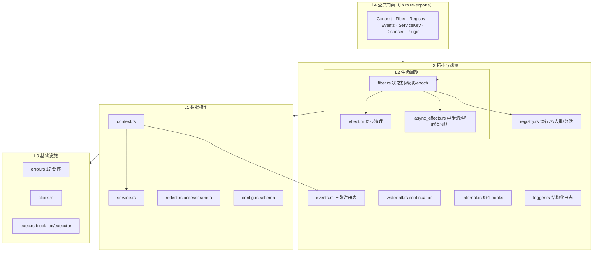
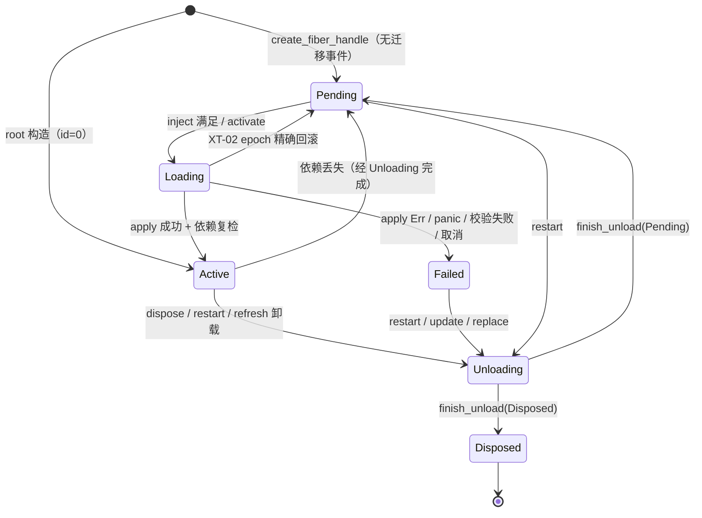

# Cordis Rust 内核架构全解

> **文档定位**：本文是「Rust 上游分析 + 可行性 + Go 设计」三件套的第一篇，面向需要理解
> **为什么这样设计**的读者，逐层解释 `reference/zeokeel-cordis-rust`（v0.6.0）的内核结构、
> 算法、锁纪律与不变量，并给出每条 `CORE-0xx` 用例的 Rust 实现证据。
>
> **证据约定**：所有 `path:line` 均相对 `reference/zeokeel-cordis-rust/`（下称“参考仓库”），
> 例如 `src/fiber.rs:1123`。规范文本见 `spec/CORDIS-CORE.md`，设计意图见 `docs/DESIGN.md`，
> 隔离承诺见 `docs/KERNEL-ISOLATION.md`。
>
> **配套文档**：
> - 逐模块深度分析：[01-context-services](analysis/01-context-services.md)、
>   [02-fiber-lifecycle](analysis/02-fiber-lifecycle.md)、[03-registry-events](analysis/03-registry-events.md)、
>   [04-runtime-config-logger](analysis/04-runtime-config-logger.md)、[05-core-cases](analysis/05-core-cases.md)；
> - Go 语言可行性：[GO-FEASIBILITY.md](GO-FEASIBILITY.md)；
> - Go 层设计：[GO-DESIGN.md](GO-DESIGN.md)。
>
> **快照说明**：Go 侧处于 v0 骨架阶段（提交 `401c55f`），部分文件正由并行成员演进；
> 本文描述 Rust 上游，Go 现状一律以 [GO-DESIGN.md](GO-DESIGN.md) 的“已实现/简化”清单为准。

---

## 目录

- [0. 结论速览](#0-结论速览)
- [1. 分层与总体结构](#1-分层与总体结构)
- [2. Context 层：作用域容器](#2-context-层作用域容器)
- [3. Service 层：服务身份与可用性](#3-service-层服务身份与可用性)
- [4. Fiber 层：六态状态机与生命周期](#4-fiber-层六态状态机与生命周期)
- [5. Effect 层：时序、撤销与取消](#5-effect-层时序撤销与取消)
- [6. 空间可组合性：注入、版本与刷新固定点](#6-空间可组合性注入版本与刷新固定点)
- [7. 事件与 waterfall：两条 lane](#7-事件与-waterfall两条-lane)
- [8. Registry：运行时拓扑与静默](#8-registry运行时拓扑与静默)
- [9. 异步模型与取消语义](#9-异步模型与取消语义)
- [10. 隔离与 panic 遏制边界](#10-隔离与-panic-遏制边界)
- [11. 锁纪律与并发不变量](#11-锁纪律与并发不变量)
- [12. 十二条不变量](#12-十二条不变量)
- [13. CORE-001…051 与实现映射](#13-core-001051-与实现映射)
- [14. Rust 专有机制清单](#14-rust-专有机制清单)
- [15. 交给 Go 移植的关键结论](#15-交给-go-移植的关键结论)

---

## 0. 结论速览

1. **两个正交维度**：时间可组合性 = 每个 context 变更加一个逆操作，fiber 持有有序 effect 列表，
   卸载按逆注册序执行；空间可组合性 = 组件声明 `inject`，运行时把 context 变化分类并自动激活/停用
   （`docs/DESIGN.md:26-82`）。
2. **五个内核对象**：Context（作用域句柄）、Service（类型擦除的共享值）、Fiber（生命周期单元）、
   Effect（可逆注册）、Events（同步/异步/waterfall 三条注册表）；Registry 是它们的运行时索引
   （`src/lib.rs:58-106`）。
3. **一条有序 effect 列表**同时容纳 sync `Disposer` 与 async `AsyncDisposer`，跨 lane 的逆注册序
   是硬语义（`src/fiber.rs:90-105,2446-2500`）。
4. **注入门是严格查询**：`lookup_for_injection` 要求条目可用 **且** 提供者 fiber `Active`；
   读 lane 是宽松查询。两者绝不合并（`src/context.rs:682-706`，CORE-006/016）。
5. **激活是事务**：apply 返回 `Ok` 之前注册的一切都在 fiber effect 列表里；`Err`/panic/校验失败/
   依赖中途消失都会逆序回滚，且用 `activation_epoch` 精确到“本次尝试”（`src/fiber.rs:1800-1963`）。
6. **生命周期互斥是 operation-level token**，不是线程身份；同一 token 重入允许，其他调用一律
   `LifecycleBusy` 且**不排队**（`src/fiber.rs:3649-3838`）。
7. **卸载是两阶段迭代级联**：先 provider-before-dependent 地 begin（置 Unloading、撤服务、取走
   effect），再逆 begin 序 drain（dependent-before-provider、child-before-parent），调用栈 O(1)
   （`src/fiber.rs:2502-3127`）。
8. **panic 遏制是默认行为，waterfall 是唯一 fail-closed 例外**；`panic="abort"` 会被编译期
   `compile_error!` 拒绝（`src/lib.rs:48-56`，`src/waterfall.rs:102-115`）。

---

## 1. 分层与总体结构

### 1.1 五个内核对象

| 对象 | Rust 表示 | 所有者 / 生命周期 | 职责 | 证据 |
|---|---|---|---|---|
| `Context` | `Arc<ContextInner>` 句柄，`Clone` 共享节点 | 每个派生节点一个 `ContextInner`；句柄可任意复制 | 作用域、服务查找起点、配置拦截、effect 注册入口 | `src/context.rs:37-57,122-124` |
| `Service` | `ServiceValue = Arc<dyn Any + Send + Sync>` | 树共享 `service_store`，条目带 owner fiber id | 类型擦除的共享值 + 可用性谓词 + schema + 版本 | `src/service.rs:15,76-100` |
| `Fiber` | `Arc<Mutex<FiberData>>` 句柄 + 全局 id | Registry 强持有；root fiber 单独保存 | 一次插件激活的全部状态、effect 列表、生命周期 | `src/fiber.rs:148,152-220,332-336` |
| `Effect` | `Disposer` / `AsyncDisposer` | 注册它的 fiber | 可逆注册：cleanup 逆序、单次、panic 隔离 | `src/effect.rs:9-79`，`src/async_effects.rs:36-78` |
| `Events` | 三张 `HashMap<String, Vec<..>>` | 每棵 context 树一个 | listener / waterfall 中间件 + internal hook 总线 | `src/events.rs:113-171`，`src/internal.rs:519` |

Registry 不是“第六个对象”，而是树级运行时：`runtimes`（插件去重）、`fibers`（全局 live 表）、
依赖索引、静默协调器四层合体（`src/registry.rs:402-482`）。

### 1.2 分层图



分层的判据是**依赖方向**：L1/L2 不知道 L3 的注册表内部结构；L0 不依赖任何上层；内核不依赖
异步运行时、HTTP、数据库、时间库等（`docs/KERNEL-BOUNDARY.md:94-127`，`Cargo.toml:60-68`）。

### 1.3 模块清单

| 模块 | 行数 | 核心类型 / 职责 | 关键证据 |
|---|---:|---|---|
| `context.rs` | 2359 | `Context`、`ContextInner`、服务注册/读取/写入、effect 注册、事件转发、logger 入口 | `src/context.rs:37-57,122-124,406-706,994-1204,1841-1956` |
| `service.rs` | 375 | `ServiceKey<T>`、`ServiceValue`、`ServiceEntry`、`ServiceGate`、`Service` trait | `src/service.rs:15-329` |
| `reflect.rs` | 218 | `Accessor`、`ContextMeta`、`extend_meta`、accessor 注册/查找 | `src/reflect.rs:28-217` |
| `config.rs` | 423 | `ConfigSchema`、`JsonConfigSchema`、`ValidationError` | `src/config.rs:22-377` |
| `fiber.rs` | 4347 | `FiberData`、六态、迁移、激活/卸载、级联、epoch、token、pending/settled | `src/fiber.rs:116-3947` |
| `effect.rs` | 80 | `Cleanup`、`Effect`、`Disposer`（单次 + 逆序 + panic 重抛） | `src/effect.rs:9-79` |
| `async_effects.rs` | 733 | `AsyncCleanup`、`AsyncDisposer`、drain frame、orphan 队列 | `src/async_effects.rs:19-629` |
| `registry.rs` | 3036 | `Registry`、`PluginRuntime`、`FiberSlots`、`DepIndex`、refresh、replace、dispose_all、quiescence | `src/registry.rs:70-2358` |
| `events.rs` | 673 | listener/waterfall 注册表、scope 过滤、sync/async 派发 | `src/events.rs:19-673` |
| `waterfall.rs` | 229 | `WaterfallNext` / `AsyncWaterfallNext` continuation | `src/waterfall.rs:43-229` |
| `internal.rs` | 787 | 9 个 typed `internal/*` hook + lifecycle bus + `contained()` | `src/internal.rs:12-102,177-301,459-763` |
| `logger.rs` | 555 | `LogLevel`、`LogRecord`、ring buffer、`Logger` facade、exporter | `src/logger.rs:30-426` |
| `clock.rs` | 68 | `Clock` / `SystemClock` | `src/clock.rs:24-67` |
| `exec.rs` | 234 | `BoxFuture`、`block_on`、`yield_now`、`join_all`、`catch_panic`、`BlockingExecutor` | `src/exec.rs:26-234` |
| `error.rs` | 157 | `CordisError` 17 变体、`ValidationError`、Display | `src/error.rs:7-157` |
| `l2.rs` | 150 | `FiberQuota`、`IsolationCapabilities`、`StalledFiber`（`supervision` feature） | `src/l2.rs:18-149` |
| `lib.rs` | 106 | crate 约束、模块声明、re-export | `src/lib.rs:46-106` |

---

## 2. Context 层：作用域容器

### 2.1 句柄与共享核心

`Context` 只有一个字段 `inner: Arc<ContextInner>`（`src/context.rs:122-124`）。`Clone` 是 Arc 克隆，
因此 `ctx.clone()` 与 `&ctx` 等价：同一个节点、同一个 fiber、同一张服务表。共享与每节点独立的字段如下
（`src/context.rs:37-57`）：

| 字段 | 类型 | 共享范围 | 语义 |
|---|---|---|---|
| `parent` | `Option<Context>` | 每节点 | 强引用父节点；根为 `None`；用于 scope/accessor/meta/intercept 向上查找 |
| `fiber` | `Fiber`（`Arc<Mutex<FiberData>>`） | 派生时继承 | 拥有者 fiber；`fiber_id()` 即 `FiberData.id` |
| `isolate` | `HashMap<&'static str, u64>` | 派生时 clone | 服务名 → scope id |
| `intercepts` | `HashMap<&'static str, Value>` | 派生时清空（`intercept` 除外） | 本节点的 config 拦截层 |
| `events` | `Arc<Events>` | 树共享 | 事件总线 + internal hooks |
| `registry` | `Arc<Registry>` | 树共享 | fiber 表、runtime 表、scope 计数器、依赖索引 |
| `logger` | `Arc<LoggerService>` | 树共享 | 内置 LOGGER 服务实例 |
| `service_store` | `Arc<Mutex<HashMap<(u64,String),ServiceEntry>>>` | **树共享一张表** | `(scope_id, name)` → entry |
| `accessors` | `Mutex<HashMap<&'static str, Accessor>>` | 每节点独立 | 计算属性；不共享 |
| `meta` | `ContextMeta` | 每节点独立 | 诊断元数据；`extend_meta` 后不可变 |
| `clock` | `Arc<Mutex<Arc<dyn Clock>>>` | 树共享一个槽 | 可注入时钟 |

`root()` 构造流程（`src/context.rs:128-193`）：新建 Events/Registry/Logger → 构造 root fiber
（id=0、state=Active、RootPlugin、SystemClock）→ 给 root fiber 写 **weak 自引用**避免
Context↔FiberData 强环（`:178-184`）→ `registry.set_root_fiber`（root 不在 fibers 表但计入静默）
→ 通过 `insert_service("logger", …)` 装入内置 LOGGER 服务（`:190-191`）。

### 2.2 派生规则

四个派生 API 都是对 `ContextInner` 的 copy-on-write，**父节点不变**（`src/context.rs:200-333`）：

| 派生 | parent | isolate | intercepts | accessors | meta | 其余 |
|---|---|---|---|---|---|---|
| `extend()` / `child()` | `Some(self)` | 继承（clone） | 空 | 新空表 | 空 | 共享 events/registry/logger/store/clock/fiber |
| `isolate(name)` | `Some(self)` | clone + `name`→**新** scope id | 空 | 新空表 | 空 | 同上 |
| `isolate_labeled(name,label)` | `Some(self)` | clone + `name`→label 对应 id | 空 | 新空表 | 空 | 同上 |
| `intercept(name,config)` | `Some(self)` | 继承 | 仅 `{name: config}` | 新空表 | 空 | 同上 |
| `child_with_meta(meta)` | `Some(self)` | 继承 | 空 | 新空表 | 给定 meta | 同上 |

关键点：派生**不 fork 数据**，只改变“查找起点”。`isolate` 每次调用都分配新的 scope id
（`src/context.rs:241-245` → `src/registry.rs:1034-1042`）；`isolate_labeled` 通过 `label_scopes`
复用同一 label 的 id（`src/context.rs:252-256` → `src/registry.rs:1022-1032`）。两者共用同一计数器，
不会撞号（`src/registry.rs:410-413`）。

### 2.3 服务作用域查找

`service_scope(name)` 从当前节点向根逐级查找 `isolate.get(name)`，**返回最近匹配**，无匹配返回 `None`，
调用侧统一 `unwrap_or(0)`（`src/context.rs:296-306`）。因此：

- 存储键 `(scope_id, name)` 在整棵树内唯一；
- 未 isolate 的所有 fiber 共享默认 scope 0；
- **无祖先回退**：最近 scope 定义了该名字但不可用时，读取返回 `None`，不会退回外层 provider
  （`src/context.rs:672-680`，CORE-014）。

### 2.4 intercept / meta / accessor / clock

- **intercept**：每次调用产生一个只含一条映射的新节点；`resolve_config` 沿 parent 链收集后
  **reverse 成 root→leaf**，head 最后追加（最高优先级）（`src/context.rs:314-333,1841-1877`）。
  intercept 只影响走 `Context::resolve_config` 的配置（内置 logger、`Service::resolve_config`），
  **不影响 plugin 配置**——后者走 `internal/config` waterfall（`spec/CORDIS-CORE.md:618-625`）。
- **meta**：`ContextMeta { entries: HashMap<&'static str, Arc<dyn Any + Send + Sync>> }`
  （`src/reflect.rs:70-73`）；`extend_meta` 派生新节点，父节点不变；读取沿 parent 链取最近命中
  （`src/reflect.rs:193-217`）。
- **accessor**：`Accessor { get, set? }`（`src/reflect.rs:28-39`），注册时挂到当前 fiber 的
  `"ctx.accessor"` internal effect（`src/reflect.rs:122-177`）；查找沿 parent 链（`:179-191`）。
  `get` 先于服务被查询，且**命中即遮蔽**：即使 getter 返回 `None` 也不会回退读 service
  （`src/context.rs:565-576`）。accessor 永远不满足 inject（严格查询只读 store）。
- **clock**：树级 `Mutex<Arc<dyn Clock>>` 槽（`src/context.rs:54-56`）；`clock()` 锁内 clone 句柄；
  `set_clock` 只允许 `fiber_id()==0`，写共享槽后遍历活 fiber + root 更新每个 `FiberData.clock`
  （`src/context.rs:345-402`）。

### 2.5 Context 层锁纪律

`service_store`、`accessors`、`clock`、`FiberData` 是四类不同的锁；共同规则是
**锁内只做 map/字段操作，用户回调在锁外**（`src/context.rs:688-694`，`src/reflect.rs:61-65`）。
`insert_service` 的 store 锁只覆盖 `contains + insert`，`note_service_changed`、事件、effect 注册、
refresh 全在锁外（`src/context.rs:498-539`）。详见 §11。

---

## 3. Service 层：服务身份与可用性

### 3.1 身份与双 lane

`ServiceKey<T>` 只携带名字：

```rust
pub struct ServiceKey<T: ?Sized + Send + Sync + 'static> {
    name: &'static str,
    _marker: PhantomData<fn(&T)>,
}
```

（`src/service.rs:152-176`）。**存储身份只有 `(scope, name)`**；`T` 只参与读取时 downcast 与写入时
类型校验。同一名字用 `ServiceKey<A>` 与 `ServiceKey<B>` 是“同一个服务槽、两个类型期望”：读错得到
`None`，写错得到 `ServiceTypeMismatch`；重复注册只看 `(scope,name)` → `DuplicateService`
（`src/context.rs:498-508`，CORE-004）。

两条 lane 的区别（`src/service.rs:29-60`）：

| lane | 存储值 | `type_id` | API |
|---|---|---|---|
| sized/typed | `Arc<T> as Arc<dyn Any>` | `TypeId::of::<T>()` | `provide/get/require/set` |
| unsized/any | `Arc<ArcWrap<T>>`（`ArcWrap` 包一层） | `TypeId::of::<ArcWrap<T>>()` | `provide_any/get_any/require_any/set_any` |

`T: ?Sized` 允许 `ServiceKey<dyn Trait>`；这类 key 只能用 `*_any`，因为 `Arc<dyn Trait>` 不能 unsize
成 `Arc<dyn Any>`（`src/service.rs:29-39`，CORE-032）。两 lane 的 `type_id` 不同，跨 lane 读写失败。

### 3.2 `ServiceEntry`

`#[derive(Clone)]` 的条目（`src/service.rs:76-100`）是所有查询的基础：

| 字段 | 类型 | 含义 |
|---|---|---|
| `value` | `ServiceValue` | 擦除后的服务值 |
| `check` | `Option<AvailabilityCheck>` | 可用性谓词（Cordis `Service.check`） |
| `schema` | `Option<Arc<dyn ConfigSchema>>` | 配置 schema；只有 `provide_service` 路径写入 |
| `owner` | `u64` | 提供者 fiber id；`ctx.set` 的所有权判据 |
| `type_id` | `TypeId` | 具体存储类型身份 |
| `provider` | `Option<Weak<Mutex<FiberData>>>` | 提供者弱引用；注入门用它判 `Active` |
| `version` | `u64` | 条目版本；依赖方按版本重算（Cordis epoch） |
| `withdrawn` | `bool` | 提供者卸载时先置 true，让依赖方先失活再移除绑定 |

`clone` 只克隆 Arc/Value，所以 `lookup*` 可以“锁内取 clone、锁外判定”（`src/context.rs:672-694`）。

### 3.3 三个可用性谓词

```
is_available()            = !withdrawn && (check == None || check())        // 读 lane
is_available_for_injection() = is_available() && provider_is_active()      // 注入门
provider_is_active()      = provider None/upgrade 失败 → true(fail-open)
                            | provider Active → true，否则 false
```

（`src/service.rs:103-143`）。三个要点：

1. `check()` 用 `catch_unwind` 包裹，panic 视为 `false`（`src/service.rs:103-111`）；
2. provider 弱引用失效或锁中毒 → **true**（历史/手工 entry 兼容，fail-open，S-3）；
3. 读 lane **不看** provider fiber 状态——provider `Loading` 时服务仍可读（TS property-read 语义，
   `src/context.rs:682-694`）。

### 3.4 注册：`insert_service` 的八个阶段

`provide*` 全部收敛到 `insert_service`（`src/context.rs:445-541`）：

1. 构造 entry：`type_id`、`provider=weak(fiber)`、`owner=fiber_id()`、`version=next_version()`；
2. 解析 scope：`service_scope(name).unwrap_or(0)`；
3. **锁 store**：已存在 → `DuplicateService`；否则 insert（锁只覆盖这里）；
4. `registry.note_service_changed(name)`：把名字放入反向依赖索引的 dirty 集合；
5. `emit_service(..., Some(value))`：internal/service 观察者（contained，不能 veto）；
6. 构造 disposer：锁内 remove entry → `note_service_changed` → emit None → `refresh_dependents`；
7. `register_effect_labeled(disposer, "ctx.provide")`：注册为 internal effect（不占用户 `max_effects`）；
8. `refresh_dependents()`：立即尝试激活依赖方。

**已知边界**：第 7 步若因 fiber 已 `Unloading/Disposed` 失败（`InactiveEffect`），entry 不会回滚
（`src/context.rs:507-539`）。Go 移植应补“注册 effect 失败 → 回滚 store”的原子性
（见 [GO-DESIGN.md](GO-DESIGN.md) §8）。

### 3.5 读取：`get` / `require` / `get_named` / `get_any`

读取顺序固定为 **accessor → internal/get waterfall → 非严格 lookup**：

1. `find_accessor(name)` 命中 → 读 accessor（panic→None）并 downcast；命中即返回
   （`src/context.rs:565-576`）；
2. 否则 `waterfall_get(self, name, terminal = lookup(name))`：hook 可观察/覆盖返回值
   （`src/context.rs:572-574`，`src/internal.rs:702-726`）；
3. 对结果 downcast：类型不符 → `None`（hook 返回错误类型也安全降级）。

`require`/`require_any` 把 `None` 映射为 `UnknownService(name)`（`src/context.rs:578-581,612-618`）。
**读 lane 永远不把 hook 虚拟服务/accessor 当成可注入服务**。

### 3.6 严格查询与注入门

`lookup_for_injection` 在非严格 lookup 基础上额外要求 `provider_is_active()`
（`src/context.rs:696-706`）；`service_available(name)` 就是它的 `is_some()`（`:666-668`）。
`dependencies_ready(ctx, deps)` 要求每个名字命中严格查询（`src/fiber.rs:1081-1088`，CORE-006/016）。

依赖激活成功后记录版本：`record_dep_versions` 用**非严格** lookup 抓 `(name, version)`
（`src/fiber.rs:1091-1099`）；“是否仍满足”用严格查询 **且** 版本相等
（`dependencies_satisfied`，`src/fiber.rs:1101-1118`）。因此 provider 被 `set`、同名重新注册、
重启，都会让依赖方卸载回 `Pending` 并重新激活（Cordis epoch，CORE-041）。

### 3.7 写入：`set` / `set_any` / `set_revertible`

`set(name, value)`（`src/context.rs:1993-2013`）：

1. 命中 accessor：有 setter → `catch_unwind(setter)`，false/panic → `AccessorWriteRejected`；
   无 setter → `AccessorReadOnly`。accessor 分支不经过 internal/set；
2. 否则 `set_revertible(name, value)`（丢弃返回的 disposer，但 inverse effect 已挂 fiber）。

`set_revertible` 的顺序不可交换（`src/context.rs:2024-2084`）：

1. `check_set_target`：无 entry → `UnknownService`；`owner != self.fiber_id()` →
   `ServiceWriteForbidden`（`:2107-2121`）；
2. `check_set_type`：`service_type_id(value)` 必须等于 `entry.type_id`，否则
   `ServiceTypeMismatch`（`:2123-2148`，DESIGN I5）；
3. fiber 处于 `Unloading/Disposed` → `InactiveEffect`（**先拒绝再写**）；
4. 锁内取 `previous = entry.clone()`；
5. `internal/set` waterfall：`terminal = write_service(...)`；hook 不调 `next` → 返回空 `Disposer`，
   store 不变（veto）；
6. 构造 inverse：恢复 `previous`（无则 remove）；若恢复时 owner fiber 正在卸载，恢复 entry 仍标
   `withdrawn`（防止复活正在释放的绑定）；然后 `note_service_changed` + `refresh_dependents`；
7. `register_effect_labeled(inverse, "ctx.set")` + `refresh_dependents`。

**代价**：每次成功写入都向 provider fiber 追加一个 inverse effect（XT-07），线性增长；高频更新应原地改
服务对象，或使用返回的 disposer 主动折叠（`src/context.rs:2024-2084`）。

### 3.8 `Service` trait、`ServiceGate`、withdraw

- `provide_service<S: Service>`：服务对象自带 `name/check/config_schema/resolve_config`；
  `name` 作为注册名、`check` 转 `AvailabilityCheck`、`config_schema` 存入 entry（唯一的公开 schema
  写入点），然后走 sized lane（`src/service.rs:251-329`）。
- `ServiceGate`：`available: AtomicBool` + `watchers: Vec<Weak<ContextInner>>`；`set(bool)` 变化时对
  每个存活 watcher 调 `ctx.refresh()`（**全量**，`src/service.rs:196-249`）。watch 不去重，重复
  `provide_gated` 会重复 refresh（可容忍的幂等浪费）。
- `withdraw_owner_services(owner)`：一次锁内遍历全表，把 `entry.owner==owner` 的条目置
  `withdrawn=true`，返回名字列表；调用点在 fiber unload 起点，之后才 drain
  （`src/context.rs:2094-2105`，`src/fiber.rs:2362-2394`，CORE-042）。

### 3.9 本层 panic 遏制点

| 位置 | 机制 | 失败降级 |
|---|---|---|
| `ServiceEntry::is_available` | `catch_unwind(check)` | panic → false |
| `Accessor::read` | `internal::contained` | panic → absent |
| accessor setter | `catch_unwind` | panic → `AccessorWriteRejected` |
| `ConfigSchema::merge` | `contained_merge` | panic → base |
| `ConfigSchema::validate` | `contained_validate` | panic → 校验失败 |
| `Service::name/check/config_schema` | `contained` | 占位值（`"<panicked service>"`） |

（`src/service.rs:103-143`，`src/reflect.rs:55-65`，`src/config.rs:114-150`，`src/context.rs:1996-2007`，
`src/context.rs:1933-1939` 附近的 logger/exporter 包装。）

---

## 4. Fiber 层：六态状态机与生命周期

### 4.1 数据结构与句柄图

`FiberRef = Arc<Mutex<FiberData>>`（`src/fiber.rs:148`）；`Fiber { data: FiberRef }` 是用户句柄
（`:332-336`）。`FiberData` 关键字段（`src/fiber.rs:152-220`）：

| 字段 | 保护 | 作用 |
|---|---|---|
| `id` / `state` | Fiber Mutex | 身份（root=0）与唯一权威状态 |
| `plugin` / `inject` / `config` / `raw_config` | Mutex | 实现与依赖声明；raw 每次激活重 resolve |
| `error` | Mutex | 最近激活失败的结构化错误；激活开始清空 |
| `parent` / `ctx` | Mutex | 父 Context / 自己的 Context；Disposed 时断边 |
| `effects` / `deferred_async` | Mutex | 唯一有序 effect 列表 + 无法 inline await 的 async 尾巴 |
| `children` | 子锁 | 直接子 fiber **弱**列表 |
| `dep_versions` | 子锁 | 激活时记录的依赖版本 |
| `activation_epoch` | AtomicU64 | 激活尝试代数（stale/XT-02 核心） |
| `status_seq` | AtomicU64 | 状态迁移序号（lifecycle 事件） |
| `lifecycle_owner/lifecycle_depth` | AtomicU64/Usize | operation token 与重入深度 |
| `pending_ops` | AtomicUsize | 在飞生命周期操作计数（settled/quiescence） |
| `dispose_requested/cancel_requested` | AtomicBool | 父卸载请求收尾 / 协作取消 |
| `last_activity_ms` | AtomicU64 | watchdog 活动时间 |
| `settle_waiters` | 子锁 | `await_settled` 等待者 |

句柄关系：`ContextInner.fiber` → 强 Fiber；子 fiber 的 `FiberData.ctx/parent` → 强 Context；
根 fiber 的 `parent/ctx` 是 weak 自引用；`children` 是弱引用；父 effect 列表中的 ownership effect
也捕获子 fiber 的 **Weak**（`src/fiber.rs:1470-1543`）。这套“强父→弱子 + 根 weak 自链接”保证整图
可被 drop（CORE-033，`src/context.rs:178-184,2344-2358`）。

### 4.2 六态状态机

`FiberState` 是 `#[non_exhaustive]` 的六态枚举（`src/fiber.rs:116-125`）：



要点：

- `Failed` 是**稳定态**：refresh 只对 `Pending` 激活、对 `Active` 卸载（`src/registry.rs:2183-2198`）；
  Failed 只能经 restart/update/replace 复活。
- `Disposed` 是**终态**：`transition` 发现当前 Disposed 直接返回（`src/fiber.rs:1129-1134`）；
  `transition_if_epoch` 同样拒绝（`:1161-1166`）；restart/update/replace 显式 `Err(Disposed)`
  （`:891-894,1010-1013,709-711`）。
- 例外：Disposed 仍有 deferred async cleanup 时，重试 dispose 走 `take_effects_begin` 的 Disposed
  分支：不迁移、不 withdraw，只排干 tail（A-9 retry，`src/fiber.rs:2362-2376`）。
- async 激活 future 被 host drop 时，`AsyncActivationGuard` 用「state==Loading && epoch==self.epoch」
  双判定只回收自己，然后置 `Failed`（`src/fiber.rs:1286-1381`）。

### 4.3 迁移写入口与事件发布

`transition(data, next)`（`src/fiber.rs:1123-1143`）：锁 → 同态 no-op → 当前 Disposed no-op →
`old=state`、`seq=status_seq.fetch_add(1)`（旧值，**首个事件 seq=0**）→ `state=next` → 快照 ctx →
释放锁 → `publish_transition`。

`transition_if_epoch(data, expected, next, epoch)`（`:1153-1179`）：同一把锁内检查
`state==expected && state!=Disposed && activation_epoch==epoch && state!=next`，通过才提交；专用于
XT-02 回滚。

`publish_transition` 锁外顺序（`:1183-1208`）：

1. `emit_status(&fiber, old)`：raw hook，`to` 由 hook 自读当前 fiber，**可能 torn**；
2. `emit_lifecycle(&fiber, old, next, seq)`：快照 from/to/seq，订阅者不属于 fiber；
3. 重新锁 data 取 registry 快照 → `registry.notify_idle()`。

### 4.4 生命周期互斥：operation-level token

| 符号 | 位置 | 语义 |
|---|---|---|
| `NEXT_LIFECYCLE_TOKEN` | `src/fiber.rs:3656` | 全局 `AtomicU64`（从 1 起） |
| `THREAD_TOKEN` | `:3658-3661` | thread-local：每线程惰性领一个唯一 token（同步入口默认） |
| `CURRENT_OP_TOKEN` | `:3663` | thread-local `Cell<u64>`：当前被 poll 的 async operation token，0=none |
| `current_lifecycle_token()` | `:3669-3676` | op token 非 0 用它，否则用 thread token |

`claim_lifecycle(data,token)`（`:3743-3758`）在 FiberData 锁内：owner==0 → 写 token、depth=1；
owner==token → depth+=1（**重入**）；否则 `Err(LifecycleBusy)`（**不阻塞、不排队**）。
`LifecycleGuard::drop`（`:3694-3725`）只释放自己的槽；owner 不匹配时 log + debug_assert 且不误清。

`begin_async_lifecycle`（`:3779-3795`）：嵌套在 async op 内（`CURRENT_OP_TOKEN≠0`）→ 复用；
外层同步 op（owner==本线程 thread token）→ 复用；否则领**全新 op token**。`WithOperationToken`
（`:3803-3838`）每次 poll `Cell::replace` 安装、RAII 还原（panic 安全、嵌套正确）。

**为什么不是线程身份**：async 生命周期在 `.await` 挂起时可能换 executor 线程；用 op token 后，
任何线程（包括上次 poll 的线程）的同步 dispose 都得到 `LifecycleBusy`（`src/fiber.rs:3727-3742`，
CORE-045）。重入判定矩阵见 [02-fiber-lifecycle §2.2](analysis/02-fiber-lifecycle.md)。

### 4.5 激活 epoch 与 XT-02 回滚

1. `begin_activation_epoch`：`activation_epoch = fetch_add(1)+1`（`src/fiber.rs:1800-1803`）；
2. 同步激活：`EpochFrame::enter(fiber_id, epoch)` 包住 `catch_unwind(apply)`，RAII 弹出
   （`:2141-2146`）；
3. 异步激活：`EpochFrameFuture` 在**每次 poll** 安装 frame，因此 future 迁移线程仍正确
   （`:1868-1898`）；
4. `ACTIVATION_FRAMES: RefCell<Vec<(fiber_id, epoch)>>`（`:1810-1817`）；`current_activation_epoch`
   取最内层匹配（`:1857-1866`）；`EpochFrame::drop` 用 `rposition` 精确移除本帧
   （embedder panic 可乱序 drop，`:1833-1848`）；
5. 兜底：不在 frame 内注册的 effect 回退到 `activation_epoch` 最新值（`src/context.rs:1038-1048`）。

`push_effect` 把 `effect.activation` 打成当前尝试的 epoch（`src/context.rs:1038-1048`）。
stale/invalidated 两种判定：

| 概念 | 判定 | 处理 |
|---|---|---|
| **stale**（被新尝试取代） | `activation_epoch != epoch` | `take_stale_effects` 按 `effect.activation==epoch` partition → drain；**不改 state、不 remove_owner** |
| **invalidated**（fiber 被 dispose/restart） | state ∈ {Disposed, Unloading} | `discard_activation_effects`：取走全部 effects + deferred drain + children sweep + `remove_owner` |

（`src/fiber.rs:1242-1279,1792-1924`）。`rollback_activation_to_pending` 只 drain 本尝试 effects，
再用 `transition_if_epoch(Loading→Pending)` 原子提交；成功才 `refresh_dependents`
（`:1935-1963`）。

### 4.6 激活管线

`activate_fiber`（`src/fiber.rs:2091-2345`）的核心步骤：

1. `begin_operation`（pending_ops++）→ `transition(Loading)`；
2. 锁内取 `plugin/config/raw_config/inject` 快照，锁外跑 `internal/config` waterfall；
3. `validate_config`：schema 校验失败 → `Failed` + `Validation`；
4. `catch_unwind(apply/apply_async)`；panic → `PluginFailed("panic: …")`；Err → 保留结构化错误；
5. 成功分支：先查 stale → 再查 invalidated → 再 `dependencies_ready`（XT-02）→
   `record_dep_versions` → `transition(Active)` → `refresh_dependents()`。

失败分支 `fail_fiber_sync/async`（`src/fiber.rs:1983-2079`）：`set_error` → `mem::take(effects)` →
逆注册序 drain（sync inline，async `dispose_blocking` 或进 deferred）→ `remove_owner` →
`sweep_children` → 若未被 invalidated 则 `transition(Failed)` → `refresh_dependents`。
apply panic → `PluginFailed("panic: …")`，校验失败 → `Validation`（CORE-028/029/038）。

### 4.7 生命周期入口

| 入口 | 关键顺序 | 证据 |
|---|---|---|
| `dispose()` | 先 `recover_parked_before_root_operation` → begin_operation → begin_lifecycle → `unload_fiber(Disposed)` | `src/fiber.rs:781-788,815-824` |
| `dispose_async()` | 先 `recover_parked_unloads_async` → begin_operation → begin_async_lifecycle + with_operation_token → `unload_fiber_async(Disposed)` | `:793-811` |
| `restart()` | begin_operation → lifecycle → FinalizeGuard → `begin_restart`（Disposed→Err、Unloading→InactiveEffect、sync+async→AsyncPluginNeedsAsync、`transition(Unloading)`）→ 卸载到 Pending → 依赖满足才激活；**激活错误被忽略**（Ok≠Active） | `:844-911` |
| `update()` | `internal/config` → schema 校验 → `internal/update`（terminal 至多一次，替换值先校验）→ 需要时 restart（同一 lifecycle token 重入） | `:962-1078` |
| `replace_plugin()` | begin_operation → lifecycle → FinalizeGuard → `begin_replace`（窗口+reindex）→ `rebind_single_fiber` → `catch_unwind(restart)` → 失败 `restore_replace` + 重载旧实现 | `:590-757` |
| `dispose_all()` | 恢复 parked → 快照 fibers + root → 逐个 `catch_unwind(dispose)` 收集 first_error/first_panic → prune → panic 优先 | `src/registry.rs:1409-1463` |

**`Ok(())` 不代表 Active**：restart/update/replace 的 post-reload 激活失败收敛为 fiber 级
`Failed`，错误在 `Fiber::error_detail()`；只有 `LifecycleBusy`/校验类错误才返回 `Err`
（`src/fiber.rs:838-843`，`spec/CORDIS-CORE.md:554-559`）。

### 4.8 子 fiber 所有权

三条并列线索（`src/fiber.rs:1457-1738`）：

1. `children: Vec<Weak<FiberData>>`：父→子弱列表，级联 DFS/child sweep 用；
2. 父 effect 列表中的 ownership effect（internal async，`owner_child=child_id`，cleanup 调
   `child.dispose_async()`）：父卸载逆序 drain 时生效，busy 则打 `dispose_requested`；
3. 子→父强 Context + 父→子弱 children 构成 fiber 树。

注册顺序（`src/context.rs:1207-1354`）：父 Disposed → Err；**深度守卫**（沿 fiber parent 链，
`MAX_PLUGIN_DEPTH=256`，只算 fiber 链，extend/intercept/meta 不耗预算）；分配 id/clock；
`register_fiber` + `register_runtime_fiber`；父状态须 ∈{Active,Loading,Pending}；push weak child；
`register_child_ownership`；最后 `emit_plugin`（此时 Pending、无 pending_ops）。

动态记账上界：

| 机制 | 位置 | 作用 |
|---|---|---|
| 子自行 dispose 时 `detach_child_ownership` 摘除父 effect + children + 诊断节点 | `src/fiber.rs:1570-1639,2408-2422` | 长寿命父动态 load/unload 不累积 |
| ownership 摊销剪枝（阈值 1024） | `:1457,1550-1562` | 父 effect 列表有界兜底 |
| 每次 push 前 `retain(effect_is_live)` | `src/context.rs:1014-1020` | disposed 条目及时清除 |
| `max_child_fibers` 只数活 child | `src/context.rs:1249-1280` | 陈旧条目不占配额 |
| `max_effects` 只数 `!internal` | `src/context.rs:1021-1036` | 内核记账不耗宿主预算 |

### 4.9 两阶段迭代级联

`begin_cascade(data, target)`（`src/fiber.rs:2840-3011`）返回 **begin 序** frames，调用方逆序 drain：

**Phase 1a：依赖 dependent（provider-before-dependent）**

1. `begin_frame(root, root=true)` → `take_effects_begin`：置 Unloading、取 effects+deferred、记 ctx、
   `withdraw_owner_services` + `note_service_changed`；
2. 从 root 的 withdrawn 服务名出发，用 `dependents_of_services(frontier)` 取候选（索引不可用 →
   index_failed 回退）；候选按 fiber id 排序；对 `fiber_is_unready_active`（Active + Sync + 依赖不满足）
   执行 `begin_frame(candidate, Pending, non-root)`；新 frame 的 withdrawn 扩展 frontier；
3. 有界轮数 `limit=fiber_count+2`；中途索引窗口打开（replace 改 inject）→ 检查 `dep_index_epoch`
   变化，回退 full scan；
4. 索引不可用 → 每轮 `find_unready_active()` 全量扫描，直到固定点/上限（C2 backstop）；
5. `begin_frame(non-root)` 对 Disposed/Unloading 直接 `Ok(None)`（**永不重复取 effect**）；
6. 任一 begin 失败 → `rollback_cascade(frames)`：已 begin 帧**逆序** drain（contained）。

**Phase 1b：ownership descendants**：`stack = child_fibers(data)` → while pop：
`begin_frame(child, Disposed, non-root)` → `stack.extend(child_fibers(child))`；帧数超 limit →
log+break（剩余 child 存活可重试）。begin 序 = DFS 前序 ⇒ 逆序 drain = 子先于父；依赖 dependent
在 child 之前 begin ⇒ 逆序时 child → dependent → provider。

**Phase 2：逆序 drain**：dependents 逆序 `drain_blocking`（drain effects → sweep children →
finish_unload），panic 记 first 只 log；root 最后 drain，其 panic 在状态落地后 `resume_unwind`。

### 4.10 busy child 与 FinalizeGuard

`sweep_children_sync/async` LIFO 遍历 children：`child.dispose()` 返回 Ok → 已回收；
`LifecycleBusy` → `request_child_dispose` 打 `dispose_requested` 并继续；panic → contained、打标、
记 first payload 并继续（`src/fiber.rs:1669-1738`）。

`FinalizeGuard`（`:1774-1789`）在 restart/update/replace 的所有退出路径上：若
`dispose_requested && state!=Disposed` → 清 flag → `Fiber.dispose()`（同 token 重入），外层再
`catch_unwind`（guard 自身绝不 unwind）。这是“父已卸载 + 子当时 busy”的子 fiber 不会永久 Active
的闭环（`:1752-1765`）。

---

## 5. Effect 层：时序、撤销与取消

### 5.1 数据结构

| 类型 | 定义 | 说明 |
|---|---|---|
| `EffectMeta`（公开） | `{ label, children: Vec<EffectMeta> }` | `get_effects` 诊断树 |
| `EffectNode`（内部） | `{ label, children, parent, owner_child }` | 树节点；`owner_child` 标记 ownership effect |
| `EffectKind` | `Sync(Disposer)` / `Async(AsyncDisposer)` | 双 lane |
| `FiberEffect` | `{ kind, meta, activation: u64, internal: bool }` | `activation`=epoch；`internal`=内核记账 |
| 有序列表 | `FiberData.effects: Vec<FiberEffect>` | **sync/async 共享一条列表** |
| deferred | `FiberData.deferred_async: Vec<AsyncDisposer>` | 无法 inline await 的 tail |

（`src/fiber.rs:19-113,172-182`）。`effects` 的 push 顺序 = 注册完成顺序；drain 用 `rev()`。

### 5.2 注册路径

| 入口 | 流程 | 位置 |
|---|---|---|
| `ctx.effect/effect_labeled` | 建 node → attach（挂栈顶）→ state 检查（Disposed/Unloading → InactiveEffect）→ push effect_stack → 执行 `setup()` → 弹栈 → `push_effect(internal=false)` → 返回 Disposer | `src/context.rs:1066-1096,1132-1146` |
| `ctx.effect_async*` | 同上，返回 `AsyncDisposer` | `:1098-1128,1170-1183` |
| `ctx.effect_future/stream` | future/stream 包装成 async cleanup，同路径 | `:1648-1740` |
| `ctx.attach_effect` | 不执行 body，把已有 Disposer 作为 **user** effect 挂到当前 fiber | `:795-802,935-966` |
| 内核记账 | `register_effect_labeled(..., internal=true)` | `:933-941` |
| child ownership | `EffectNode::new_owned("ctx.plugin", child_id)`，AsyncDisposer 捕获 Weak child | `src/fiber.rs:1470-1544` |

`push_effect` 统一守卫（`src/context.rs:994-1051`）：① Disposed/Unloading → `InactiveEffect`；
② `retain(effect_is_live)` 剪掉已 dispose 条目；③ `max_effects` 只数 `!internal`；④ 打 epoch 标签；
⑤ push。

### 5.3 逆序 drain 与顺序语义

统一模式：`for effect in effects.into_iter().rev()`（逆注册序）逐项执行；单个 cleanup panic 隔离并
记录**第一个** payload，全部跑完后在安全点重抛（CORE-011/030）；`deferred_async` 在所有普通 effect
之后 drain（newest-first 存、从头取）。

| 变体 | 位置 | 行为 |
|---|---|---|
| `drain_effects_blocking` | `src/fiber.rs:2446-2466` | sync；async 用 `dispose_blocking`（BlockingExecutor/thread-park block_on）；返回 first panic |
| `drain_effects_async` | `:2471-2500` | 逐个 await async cleanup（顺序确定，不并发） |
| `CascadeFrame::drain_blocking` | `:2575-2580` | drain effects → sweep children → finish_unload(target) |
| `CancelSafeUnload::drain` | `:3520-3563` | 取消安全：in-flight effect 保留在 vec 直到完成；future drop 时保序重试 |
| `AsyncFrameUnload::drain` | `:3210-3248` | 非根帧取消安全版；drop 时 park_cancelled_frame |
| `fail_fiber_sync_inner` | `:1991-2008` | 失败回滚：sync inline，async blocking 或推 deferred |
| `rollback_epoch_effects` | `:1391-1416` | epoch 精确回滚：sync inline，async 全 deferred |
| `FiberData::drop` | `:234-330` | 最后安全网：逆序 sync cleanup；async 无 executor 或 unwinding → orphan |

**顺序性质**（务必保留的可观察语义）：

1. sync/async 混排 → **跨 lane 逆注册序**成立（CORE-007/038）；
2. `deferred` 是更晚注册、更早 drain 的尾；下次 dispose 时先于主列表 drain；
3. **嵌套 effect 的列表位置**：`run_labeled_effect` 先执行 body（其中嵌套 effect 已 push）再 push
   自己 → 内层 effect 在列表更靠前 → fiber 级逆序 drain **先执行外层 cleanup 再执行内层 cleanup**
   （诊断树嵌套 ≠ drain 嵌套）。Go 移植必须保持一致或明确改语义。

### 5.4 `Disposer` 状态机（sync）

`src/effect.rs:22-79`，`inner: Arc<Mutex<Option<Vec<Cleanup>>>>`：

```text
Armed(slot=Some) ──dispose()──► slot=None，从尾部 pop（逆注册序）执行
                                 │ 每个 callback catch_unwind，记录第一个 panic
                                 ▼
                           全部跑完 → resume_unwind(first_panic)（CORE-011）
重复 dispose：slot=None → no-op（单次/幂等）
Drop（仅最后一个 handle）：strong_count(inner)==1 时调用 dispose()，panic 被 contained+log
```

`Cleanup = Box<dyn FnOnce()+Send>`、`Effect = Vec<Cleanup>`（`:9-20`）；`is_disposed()` = slot None
（`:55-58`）。CORE-030：panic 不跳过剩余 cleanup，drain 完再重抛第一个。

### 5.5 `AsyncDisposer` 状态机

字段：`inner: Arc<Mutex<Option<Vec<AsyncCleanup>>>>` + `state: Arc<DisposeState>`
（`src/async_effects.rs:74-78`）。`DisposeState`（`:152-159`）：`done/cancelled/claimed: AtomicBool`
+ `waiters: Mutex<Vec<Waker>>`；`is_settled()=done&&!claimed`；`claim()` CAS(false→true) 取得
teardown 所有权并清 done/cancelled；`finish_drain()` 置 done 清 cancelled release+wake；
`cancel()` 置 cancelled+done release+wake（cancelled 表示“有 restored cleanups 待重试”）。

```text
Idle(claimed=false,done=false)
 ├─ dispose()/dispose_blocking() → claim 成功 → Draining（唯一 owner）
 │    ├─ 正常：逐项 await（first panic 记录）→ finish_drain → resume_unwind(first)
 │    ├─ future 被 drop（cancel）：CancelSafeDrain::drop 把未启动 cleanup 放回 slot（slot 为空时）、
 │    │   state.cancel()；in-flight cleanup 丢失（不可恢复，log）→ 下次 dispose 重新 claim 继续逆序跑
 │    └─ 列表空：finish_drain → no-op
 ├─ 他人正在 Draining（claim 失败）
 │    ├─ 本调用栈正处于该 disposer 的 drain frame（self-join）→ 立即返回
 │    └─ 普通 joiner → wait_done()；正常 finish → 返回；对方 cancelled → 重新 claim 重试
 └─ 已 settled（done&&!claimed）：重复 dispose no-op（cancelled 时除外，需重试）
```

关键点：

- `dispose()` 循环（`:444-517`）：claim 失败先查 `drained_by_current_thread()`（self-join→return），
  否则 `wait_done().await`；正常返回、cancelled 则 `continue` 重试；claim 成功后 `take()`，
  `CancelSafeDrain` 包住列表，`pop` 逐项执行（`catch_unwind(cleanup)` 建 future +
  `catch_panic(DrainScopeFuture)` 逐 poll），完成后 `finish_drain` + `resume_unwind` 第一 panic。
- **drain frame / self-join（S-2/R2-1）**：thread-local `DRAIN_FRAMES: RefCell<Vec<usize>>`
  （`:80-92`），key=`&DisposeState` 地址（稳定身份 `:210-214`）；`DrainScopeFuture` 每个 poll 进入
  frame（`:122-139`）；`drained_by_current_thread()`=当前线程栈含该 key（`:216-223`）。
  **不是 thread id 判断**：同一 worker 上的无关 joiner 必须继续等。
- `dispose_blocking()`（`:553-587`）：先 self-join 短路；`is_settled()&&!cancelled` 才 no-op；
  否则 `block_on_unit(clone.dispose())` —— **join 语义**：阻塞到全部 cleanup 真正完成。
- `CancelSafeDrain::drop`（`:237-266`）：remaining 非空且 slot 空 → 放回（保序，下次 pop 继续逆序）；
  `state.cancel()`；in-flight cleanup future 无法恢复（Rust 无 cancel-safe await），log。
- `discard()`（`:519-534`，R3-A4 专用）：取走 cleanups 丢弃 + `finish_drain`，使 Drop 安静 no-op。
- `Drop`（`:598-629`）：cancelled→只 log；最后一个 handle 且未 disposed 且线程未 unwinding →
  contained `dispose_blocking()`；unwinding → 取走丢弃+log。

### 5.6 deferred 与 orphan 队列

- fiber 级 deferred：取消/同步失败时 AsyncDisposer 直接挪进 fiber 的 `deferred_async`（不在 disposer
  内部），由下次 fiber dispose/drain 处理（`src/fiber.rs:2471-2500`）。
- orphan queue（XT-01，`src/async_effects.rs:268-434`）：`ORPHAN_CAPACITY=256`；
  `ORPHANS: Mutex<Vec<AsyncDisposer>>`；3 个原子计量（累计泄漏、累计失败、队列 gauge）。
  `orphan_async_disposer` 仅在 `FiberData::drop` 无法安全跑 cleanup 时调用：队列未满入队；
  满/中毒则 `mem::forget`（绝不就地 Drop，Drop 可能 block）+ 累计计数；从不阻塞、从不 unwind。
  公开 API：`orphan_async_cleanups_pending()`、`orphan_async_cleanup_count()`、
  `orphan_async_cleanup_failure_count()`、`drain_orphan_async_cleanups()`（先整体 take 再逐个
  `dispose_blocking`，幂等、返回处理数、失败 contained+计数；必须在非 reactor 线程调用）。

### 5.7 墓碑、剪枝、诊断树

- **disposed 条目惰性剪枝**：`push_effect` 每次注册前 `retain(effect_is_live)`
  （`src/context.rs:1014-1020,1053-1062`）→ 不占配额、列表不因 register/dispose 循环无界增长。
- **ownership 摊销剪枝**：`OWNERSHIP_PRUNE_THRESHOLD=1024`，注册新 ownership 时若
  `effects.len()>=1024` 删除 owner_child 已标记且已 dispose 的条目（`src/fiber.rs:1457,1550-1562`）。
- **精确摘除**：`detach_child_ownership` 在子自行 dispose 后从 parent.effects 摘除
  `owner_child==child_id` 项、从 children 移除弱条目、unlink 诊断节点；随后**锁外**
  `AsyncDisposer::discard()`（不是 drop）。幂等（`:1570-1639`）。
- **诊断树**：`Fiber::get_effects()` 只返回仍持有资源的顶层节点，子节点仅当与 live 中某节点
  `Arc::ptr_eq` 才保留（C3，`:372-396`）。

---

## 6. 空间可组合性：注入、版本与刷新固定点

### 6.1 注入门

```
dependencies_ready(ctx, deps)     = ∀ name ∈ deps: lookup_for_injection(name).is_some()
dependencies_satisfied(fiber, ctx) = ∀ name ∈ inject: lookup_for_injection(name)
                                     && recorded_version(name) == entry.version
```

（`src/fiber.rs:1081-1118`）。`dependencies_ready` 用于 Pending→Loading；`dependencies_satisfied`
用于 Active→Unloading 的判定。二者都要求 provider `Active`（严格），因此 Failed/未 Active 的
provider 不能激活依赖者（CORE-005/016）。

### 6.2 provider epoch / version

- 全局单调版本：`static SERVICE_VERSION: AtomicU64`，初值 1，`next_version()=fetch_add(1)`
  （`src/service.rs:17-27`）。entry 在注册与每次 `write_service` 时取新版本。
- 依赖记录：activation 成功后 `record_dep_versions` 用**非严格** lookup 记录 `(name, version)`
  （`src/fiber.rs:1091-1099`）。
- 依赖满足：严格可用 **且** 版本相等（`:1101-1118`）→ provider 被 `set` 或同名替换都会让依赖方
  卸载回 Pending 并重新激活（Cordis epoch，CORE-041）。
- 版本只做相等比较，因此每棵树独立或全局单调均可。

### 6.3 refresh 固定点

同步 `refresh_all_impl(full)`（`src/registry.rs:2123-2205`）：

- 重入熔断：`begin_refresh` 用 `compare_exchange(0→1)`；失败仅置 `refresh_dirty=true` 并返回，
  外层循环消费 dirty（`:2094-2104`）；`RefreshGuard::drop` 在**所有退出路径**（含 panic/cancel）把
  `refresh_depth` 归零（`:670-685`）。
- 最多 64 轮；每轮取候选（full → 全量快照；否则 `refresh_candidates()`）→ 对每个 fiber 快照
  `(ctx, plugin, config, deps, recorded)`（锁外释放）→
  - `Sync + Pending + dependencies_ready` → `activate_fiber`；
  - `Sync + Active + !dependencies_satisfied` → `unload_contained(Pending)`；
  - async fiber 一律跳过；
  - 有进展或 dirty 被置位则继续。
- 异步 `refresh_all_async_impl`（`:2269-2357`）：先恢复 parked（≤8 轮），其余同上，但 Pending 按
  `is_async` 分派 `activate_fiber_async`，Active 不满足时 `unload_contained_async(Pending)`。
- `find_unready_active`（`:2227-2252`）：扫描第一个 Active 且依赖不满足的 **sync** fiber。
- `unload_contained`/`_async`（`src/fiber.rs:3441-3508`）：refresh 驱动的 unload 也
  `begin_operation` + claim lifecycle slot；busy 时本轮跳过（返回 false），后续 refresh 重试；
  cleanup panic 被遏制记录，fiber 仍到达目标态。

**用户 `ctx.refresh()` 走全量**（`src/registry.rs:2114-2121`，保证 availability gate 翻转总被看到）；
内部路径 `refresh_all` 用 dirty 候选快路径。**sync refresh 不 recovery**（见 §9.6）。

### 6.4 反向依赖索引 S1–S4

结构（`src/registry.rs:560-571`）：

```text
DepIndex {
  inject_by_fiber:      HashMap<u64, &'static [&'static str]>,   // fiber → 声明的 inject
  dependents_by_service: HashMap<&'static str, HashSet<u64>>,    // 服务名 → 注入它的 fiber 集合
  runtime_by_fiber:     HashMap<u64, PluginKey>,                 // fiber → runtime
}
```

设计约束：**纯派生状态，永不作为可用性权威**；所有决定仍由 `lookup_for_injection` +
`dependencies_ready/satisfied` 做；索引只缩小候选集（superset filter，`src/registry.rs:454-458`）。

维护时机（`src/registry.rs:1756-1805,1887-1889`，`src/context.rs:511,526-539,2078-2082,2161-2193`，
`src/fiber.rs:2389-2404`）：

| 时机 | 动作 |
|---|---|
| fiber 入注册表 | `index_fiber_deps(id, inject)` |
| fiber 最终销毁 | `unindex_fiber(id)` |
| fiber 绑/迁 runtime | `index_fiber_runtime` |
| 单 fiber 换实现 | 先开 `dep_index_begin_window` → 改 inject/plugin → reindex → 关窗口 |
| 服务出现/移除/`set`/撤回 | `note_service_changed(name)` |
| fiber 状态变化 | 不直接改索引，只 `refresh_dependents()` |

窗口/代数/失效：

- `dep_index_begin_window()` 同时 `windows += 1`、`epoch += 1`；RAII `DepIndexWindow::drop` 减窗口
  （`src/registry.rs:1520-1524,575-585`）。
- `dep_index_ready() = !broken && windows==0 && dep_index.try_lock().is_ok()`（`:1531-1537`）。
- `mark_dep_index_broken()`：索引锁 poison 或 fiber 元数据读不到时永久置位，之后退化为全量扫描
  （C2 fail-safe，`:1541-1543`）。
- **顺序不变量（P2-1）**：窗口必须在 `FiberData.inject` 变更**之前**打开，否则并发 cascade 可能
  读到「可信索引 + 旧反向边」，漏掉刚变成 dependent 的 fiber（`src/fiber.rs:534-541`）。

### 6.5 cascade 候选前沿（S3）

`begin_cascade` 的 Phase 1a（§4.9）每轮：

1. 从 root 的 withdrawn 名字出发 `dependents_of_services(&frontier)` 取候选（`:2866-2901`）；
2. 每个候选重新做 `fiber_is_unready_active`（Active && sync && !dependencies_satisfied），
   绝不只看索引（`:2888-2895`）；
3. 候选按 fiber id 排序保证确定性（`:2883`）；新 frame 的 withdrawn 并入 frontier，直到不动点或
   `fiber_count+2` 上界；
4. 索引不可信/中途失效 → `index_failed=true` → `find_unready_active()` 全量扫描重跑
   （`:2958-2984`）；
5. debug 可选交叉校验：候选前沿必须覆盖全量扫描能发现的所有 unready fiber，否则
   `debug_assert!(false)`（`:2920-2957`，`src/registry.rs:1658-1669`）。

### 6.6 可用性 gate 翻转

`ServiceGate::set`（`src/service.rs:216-228`）对每个存活 watcher 调 `ctx.refresh()`（全量），
依赖方在 gate 关闭时卸载到 Pending、重开时重新 apply（CORE-006）。
`provide_checked` 本身不刷新（`src/context.rs:414-431`，CORE-013）；`provide_gated` 通过 gate 自动
刷新。

### 6.7 provider-withdrawal order

fiber 卸载顺序固定为：`transition(Unloading)` → `withdraw_owner_services(owner)`（把 owner 的
entry 全置 withdrawn）→ 依赖方失活（refresh/cascade）→ 再 drain 自己的 effect（provide disposer
才 remove entry + emit None）（`src/fiber.rs:2362-2404`，`src/context.rs:526-540`，CORE-042）。
这样依赖方的 cleanup 在 binding 仍存在但 `withdrawn=true` 时运行，读 `get` 得到 `None`，不会观察到
“值还在但提供者已死”的窗口。

---

## 7. 事件与 waterfall：两条 lane

### 7.1 Events 存储与 listener 记录

三张独立 `Mutex<HashMap<String, Vec<…>>>`：`listeners`、`waterfall_listeners`、
`async_waterfall_listeners`；一次派发只锁对应 map 取快照，之后无锁执行（`src/events.rs:165-171`）。
`next_id: AtomicU64` 共用；Disposer 按 id 精确移除。

`Listener` 字段（`src/events.rs:119-128`）：

| 字段 | 语义 |
|---|---|
| `id` | 总线内唯一，移除键 |
| `owner` | 注册时 `ctx.fiber_id()`；`remove_owner` 按此清空 |
| `body` | `Sync(ListenerFn)` / `Async(AsyncListenerFn)`，分开存、分开派发 |
| `scope` | 注册时 `inner.isolate.clone()` 快照 |
| `global` | 绕过 scope 过滤 |
| `once` + `called: Arc<AtomicBool>` | 一次性；`swap(true)` 保证并发下只执行一次 |

`WaterfallEntry`/`AsyncWaterfallEntry` 有 `id/owner/callback/scope/global`，**没有 once**
（`:130-146`）。`ContextScope` 是 `HashMap<&'static str,u64>` 别名（`:76-77`）。

### 7.2 isolate 过滤 = 映射相等

`passes(global, listener_scope, dispatch_scope)`（`src/events.rs:200-209`）：

- `global == true` → 放行；
- 否则 `dispatch_scope == None`（直接调 `Events::*`）→ 放行；
- 否则 **映射相等**才放行：`dispatch_scope == listener_scope`。

要点：是“isolate map 相等”，不是“子树遍历”；`root` 与 `root.isolate("x")` 是两个不同 scope，
互不收事件（CORE-019）。scope 是注册时快照，之后子 context 的 isolate 变化不影响已注册 listener。
`Context` 层派发始终传 `Some(&inner.isolate)`（`src/context.rs:1785-1835`）。

### 7.3 注册与 owner 回收

```
ctx.on(name, l) → on_with(name,false,false,l) → on_with_options(...)
   owner = fiber_id()
   (callback, options) = resolve_listener(...)  ← internal/listener bail hook 可替换
   callback = wrap_once_listener(callback, once, slot)
   disposer = Events::add_listener(...)
   adopt_listener(disposer, slot, "ctx.on")     ← fiber-owned internal effect
```

（`src/context.rs:1480-1544`，`src/events.rs:559-673`）。`on_async/on_async_with` 直接
`add_async_listener`，**绕过 `internal/listener` hook**（XT-06），options 固定
`{prepend, global:false, once:false}`；仍是 fiber-owned effect。waterfall 注册同样 fiber-owned，
公开 API 默认无 prepend/global/once。

owner 回收三道防线：正常 unload `finish_unload → events.remove_owner`；激活失败/取消回滚
`fail_fiber_*`、`discard_activation_effects*`、`rollback_activation_to_pending*` 显式
`remove_owner`；兜底 `FiberData::drop` 时 `catch_unwind(remove_owner)`（`src/events.rs:275-291`，
`src/fiber.rs:1269,1278,2014,2062,234-246`）。

### 7.4 同步派发

四个函数结构相同（`src/events.rs:293-371`）：`emit_dispatch(mode,name,args)` → `listener_snapshot`
（克隆 Vec、释放锁）→ 遍历过滤 `passes` → 只处理 `Sync` → once 判断 → `call_sync`。

- `emit`：忽略返回值（Bail 也不停）；
- `bail`：`result.into_bail()` 为 `Some` 立即返回该值（**第一个非 null/false 的 Bail**）；
- `parallel`：与 emit 相同（sync 无 await，语义等价）；
- `serial`：同步版直接复用 bail；
- `call_sync`：`catch_unwind(callback)`；panic → 记录并当作 `Continue`（CORE-031）；
- once：`called.swap(true)` 为真则跳过；执行后 `removeListener`（`:304-310`）。

**语义判定**：`Bail(Null)`/`Bail(false)` 不 bail（`into_bail`，`:19-38`，CORE-018）；
派发期间新增 listener 不参与本轮，被移除者仍可能在本轮快照里被调用一次（`:470-471`）。

### 7.5 异步派发

`parallel_async`（`src/events.rs:373-414`）：

1. `emit_dispatch(Parallel, ...)`；
2. 按注册顺序：sync body **inline 执行**（含 once/panic）；async body 在 `catch_unwind` 中**构造
   future**（构造 panic → 记录，视为 Continue），`boxed(catch_panic(future))` push 进 `pending`；
   once 在构造后立即移除；
3. `exec::join_all(pending).await`：手写轮转 poll，每轮按输入顺序各 poll 一次；任一 future panic
   被捕获并记录，派发继续；`Bail` 结果被忽略；
4. 顺序保证：**所有 sync listener 先于任何 async listener body**；async body 并发交错。

`serial_async`（`:415-468`）：sync inline；async 构造后立即 `.await`；严格注册顺序；`into_bail`
命中即返回，后续不再执行；panic 记录并 Continue。

两条 lane 互斥：sync 派发**绝不 poll** async listener；async 派发会 inline 跑 sync listener
（`spec/CORDIS-CORE.md:404-457`）。

### 7.6 internal：9 个 typed hook + lifecycle bus

| # | event | 签名要点 | 语义 |
|---|---|---|---|
| 1 | `internal/plugin` | `Fn(&Fiber)` | fiber 创建后、激活前广播 |
| 2 | `internal/status` | `Fn(&Fiber, FiberState /*old*/)` | 每次真实迁移；`to` 自读可能 torn |
| 3 | `internal/config` | waterfall `Fn(&Fiber, Value, &ConfigNext) -> Value` | 每次激活与 update |
| 4 | `internal/service` | `Fn(&Context, &str, Option<&ServiceValue>)` | provide/remove 观察 |
| 5 | `internal/update` | waterfall `Fn(&Fiber, Value, bool, &UpdateNext)` | terminal 提交 raw+restart；panic=allow |
| 6 | `internal/get` | waterfall `Fn(&Context,&str,&GetNext)->Option<ServiceValue>` | None=服务缺失，不是 skip |
| 7 | `internal/set` | waterfall `Fn(&Context,&str,&ServiceValue,&SetNext)->bool` | 返回是否已写 |
| 8 | `internal/listener` | bail `Fn(&ListenerRequest)->Option<ListenerOverride>` | 第一个 Some 生效 |
| 9 | `internal/dispatch` | `Fn(&DispatchInfo)` | 仅最外层用户事件；递归门闩；`internal/` 前缀跳过 |

（`src/internal.rs:12-22,177-301,599-763`）。**额外 lifecycle bus**（不是第 10 个 `internal/*`）：
`LifecycleHookDyn = Fn(&Fiber, from, to, seq)`，锁内快照 from/to/seq 再锁外投递；
订阅**不属于 fiber**、不随安装 fiber 卸载（`src/internal.rs:506,615-633`，`src/context.rs:2252-2268`）。
`LifecycleEvent` 是 `#[non_exhaustive]`，字段 `fiber_id/name/from/to/seq`；seq per-fiber 单调
（0 起、可乱序到达，按 `(fiber_id,seq)` 重排，`src/internal.rs:243-273`）。

两种所有权：`Context::on_internal_*` 写共享 bus + 注册 fiber internal effect（随 fiber 卸载）；
`InternalBus::on_*` 由调用方自持 Disposer（必须手动 dispose）；`on_lifecycle` 非 fiber 绑定。
两者写**同一有序 hook 列表**（`src/internal.rs:459-500`，`src/context.rs:2200-2337`）。

### 7.7 waterfall continuation

`WaterfallNext { remaining: Arc<[Fn]>, args: Arc<[Value]>, terminal }`（`src/waterfall.rs:56-75`）。
`next()`（`:94-119`）：

```text
match remaining.split_first():
  Some((listener, rest)) =>
      next = WaterfallNext { remaining: rest, args: clone, terminal: clone }
      catch_unwind(listener(args, &next)) → panic: log + resume_unwind
  None => (terminal)(args)      // 不在 catch_unwind 内（sync）
```

- 链顺序 = 注册顺序：第一个注册的是最外层 middleware（洋葱模型，CORE-020）；
- `next()` 可多次调用：每次从 `self.remaining` 重新 split，剩余链与 terminal 重跑；
- `terminal()` 跳过剩余链直接跑链尾；
- `args` 对所有 middleware 是同一份（只能改写返回值，不能改参数）；
- async 版 `next()` 返回 `BoxFuture`，顺序/洋葱模型一致（`:161-184`，`src/events.rs:493-520`）。

**panic 策略**：waterfall 是唯一 fail-closed 例外——panic 记录后中止整条链并重抛给派发者；剩余
middleware 与 terminal 不执行（`src/waterfall.rs:102-115`）。原因：waterfall 常被用作策略/鉴权，
把 panic 降级为 Null 会把“策略失败”变成“允许”。注意 sync terminal 调用不在 `catch_unwind` 内
（`:117`），仍 fail-closed 但缺日志；async 整条 future 被 `exec::catch_panic` 包裹。

### 7.8 两条 lane 对比

| 维度 | bail lane（emit/bail/parallel/serial） | waterfall lane |
|---|---|---|
| 控制流 | listener 返回值决定是否停链 | 是否调用 `next` 决定是否继续 |
| 停止方式 | `Bail(非 null/false)` | 返回而不调用 `next` |
| 结果 | 首个 bail 值 / 忽略（emit） | 最外层 middleware 的返回值 / terminal 值 |
| 中间件能力 | 无（不能改写后续结果） | 完整洋葱模型，可改写返回值、可重复 `next` |
| panic | 遏制为 Continue | 记录并重抛（fail-closed） |
| 类型 | `EventResult` | 无 Bail 类型，直接 `Value` |

---

## 8. Registry：运行时拓扑与静默

### 8.1 PluginKey 与 dedupe

`PluginKey::Type(TypeId)`（`plugin_typed`/`inject` 用）与 `PluginKey::Named(&'static str)`
（`Plugin::name()` 默认）（`src/registry.rs:120-128`）。`ctx.inject` 用
`TypeId::of::<Injected<F>>()`，因此每次 inject 调用是独立 runtime（FIX-20，`src/context.rs:1446-1477`）。

C2 元数据遏制：`name/key/inject/config_schema` 是 embedder 代码，panic 时分别降级为
`"<panicked plugin>"` / `Named("<panicked plugin>")` / `&[]` / `None`，记录 error 且绝不 unwind
出 `ctx.plugin`（`src/registry.rs:205-338`，常量 `PANICKED_PLUGIN_NAME :223`）。所有 key-panic 的
插件共享同一个 runtime，`keys/replace/delete` 无法单独寻址（`:250-258`）。

dedupe：`register_runtime_fiber` 用 `runtimes.entry(key).or_insert_with(...)`；最后成员被移除时
`unregister_runtime_fiber` 删表，另有 `prune_empty_runtimes` 兜底（`:1780-1805,1823-1890,1920-1938`）。

### 8.2 FiberSlots

`PluginRuntime.fibers` 是 tombstone 槽位（`src/registry.rs:484-558`）：`slots: Vec<Option<Fiber>>`
保留插入顺序、`positions: HashMap<u64,usize>`、`live: usize`；删除 O(1) 置 None；当
`slots.len() > live*2+64` 时 `compact()`（均摊 O(1)）。动机：旧 `Vec + retain` 在 5000 fibers
共享 runtime 的 fanout dispose 下是 O(n²)（实测 ~2.2s，`:484-490`）。

### 8.3 快照语义

`size/get/has/keys/values/entries/for_each/fibers/fiber_count` 各只锁一个结构，跨调用可短暂不一致；
需要一致视图用 `is_idle()/when_idle()`（`src/registry.rs:786-1512`，CORE-022/049）。
`for_each` 先 `entries()` 再锁外回调（`:1494-1503`）。`fibers()` 的 doc comment 声称包含待 prune 的
disposed fiber，但实现 `finish_unload` 就立即移除（`src/fiber.rs:2421-2432`）——**注释与实现不一致**，
以 live 表为准（03 分析 §3.2 记录了这个陈旧风险）。

### 8.4 replace 的原子流程

**阶段 A：`rebind_runtime(old, kind)`**（`src/registry.rs:1334-1403`）

1. `kind.key()/name()` 先求值（元数据 panic 已 C2 遏制）；
2. 锁 `runtimes`：`remove(old)`，不存在 → `InvalidPlugin`；
3. 若 `new_key` 已存在 runtime 则 **merge**，否则新建并插入；
4. 释放锁后对每个旧 fiber 快照 `(Fiber, 旧 kind, 旧 runtime_key)` 形成 `RebindUndo`；
5. 把 fibers push 进目标 runtime；
6. 对每个 fiber `swap_plugin(kind)`（开/关索引窗口 + reindex）+ 写 `runtime_key`；失败 →
   `undo_rebind`；
7. `heal_disposed_registrations`：迁移窗口内被并发 dispose 的 fiber 不能被新 runtime 持有（D-1）。

**阶段 B：逐 fiber reload**（`:1088-1165`）：`catch_unwind(restart())`；`Ok(Ok)` → 下一个；
`Ok(Err)` → `rollback_replace`；`Err(payload)` → `PluginFailed("… reload panicked: …")` 后回滚。

**阶段 C：回滚**（`:1167-1228,1287-1332`）：`undo_rebind` 恢复 runtime 表与 fiber 绑定；对
`0..reloaded`（已换新实现）+ 失败 fiber 用**旧实现** `restart_contained`；`replace_rollback_result`
决定返回原错误 / `Rollback`。`reloaded==0` 或 rollback error 是 `LifecycleBusy` 时返回原错误
（结构性恢复已完成）。

**语义要点（XT-05）**：`Ok` 只表示 swap/rebind/reload 机器跑完；若 reload 的 **activation** 失败，
`restart()` 收敛为 `Ok(())`、fiber 落 `Failed`，runtime 保持绑定新实现、**旧实现不恢复**；只有
`LifecycleBusy`/校验类错误才触发阶段 C（`:1101-1129`）。

### 8.5 dispose_all

`Registry::dispose_all`（`src/registry.rs:1409-1463`）：① `recover_parked_unloads_blocking`；
② 快照 fibers 逐条 `catch_unwind(fiber.dispose())` 记录 first_error/first_panic、永不中断；
③ 对 root 同样尝试；④ `prune_empty_runtimes`；⑤ panic 优先（error 先 log 再 resume_unwind 第一个
panic）；只有 err → Err；只有 panic → 重抛；否则 Ok。Ok 后 registry 空且 idle；Busy fiber →
`Err(LifecycleBusy)` 且可能留未清理 fiber（调用方重试，XT-10）。

### 8.6 Quiescence 与 when_idle

Registry 字段（`src/registry.rs:402-482`）：`pending_registrations: AtomicUsize`、
`registration_owners: Mutex<HashMap<ThreadId,usize>>`、`idle_waiters: Mutex<Vec<(u64,Waker)>>`、
`parked_unloads`、`active_unloads`、`recovering_parked`。

- `is_idle()`（`:871-873`）+ `is_idle_excluding_with_total(own,total)`（`:888-917`）：
  `total-own==0`（严格版 own=0），且所有 fiber+root：state ∉ {Loading,Unloading} 且
  `pending_ops==0`。
- 注册窗口：`Context::plugin*` 在 `create_fiber_handle` **之前** `begin_registration()`
  （`src/context.rs:1379-1433`），guard 覆盖到 activation；`RegistrationGuard::drop` 按**创建线程**
  释放 owner（跨线程 drop 也不错扣，C4）+ pending-- + notify_idle（`src/registry.rs:694-715,
  1940-1969`）。
- `when_idle()` 的 recovery-aware 循环（`:963-1008`）：每轮在同一把 owner-map 锁内取 `(own,total)`
  （防 TOCTOU）；`is_idle_excluding_with_total(own,total) && !has_parked_unloads()` → return；
  有 parked 时 active unload→等，否则 `recover_parked_unloads_async` 后重试；否则等
  `wait_idle_or_recoverable()`；轮数上限 `fiber_count+8`（≥16），超限 log 后回退纯可恢复等待
  （不 hang）。
- `notify_idle` 调用点：publish_transition、end_operation、RegistrationGuard::drop、
  RecoveryGuard::drop、park_unload、end_unload_activity（`:927-937`）。
- **边界**：两个线程的注册窗口互相 `when_idle()` 会死锁（内核不检测环）；`apply`/`apply_async` 内
  **不可**同步等待 idle（自己 pending_ops>0 会等自己，XT-04）。

---

## 9. 异步模型与取消语义

### 9.1 Future / executor

内核自带依赖零的 thread-park `block_on`（只推进自我唤醒的 future，`src/exec.rs:49-98`）；
`yield_now` 首次 Pending + 自唤醒、第二次 Ready（`:100-123`）；`join_all` 每轮按输入顺序各 poll
一次、保序返回（`:125-161`）；`catch_panic` 用 `catch_unwind` 包住每次 poll（`:163-187`）。
`BoxFuture<'a,T> = Pin<Box<dyn Future<Output=T> + Send + 'a>>`（`:26-27`）。

**局限**：`block_on` 只能在 future **自我唤醒**时推进；Tokio timer/socket 等 reactor-backed future
需要外部 runtime 已在驱动。因此同步卸载边若直接 `block_on` 会 park 唯一 worker → 死锁。

### 9.2 sync↔async 桥：BlockingExecutor

`BlockingExecutor { fn block_on(&self, BoxFuture<'static, ()>) }`；`set_blocking_executor` 首次安装
胜（`OnceLock` 失败返回 false）（`src/exec.rs:202-234`）。使用点：`Fiber::dispose/restart/update`、
`AsyncDisposer::dispose_blocking` 等同步卸载边，用于驱动 deferred async cleanup（CORE-034）。
`FiberData::drop` 用 `has_blocking_executor()` 判断：无 executor 或正在 panicking 时**跳过** async
cleanup（进 orphan 队列），只在有 executor 时于 Drop 内 `dispose_blocking`（`src/fiber.rs:234-330`）。

### 9.3 取消：`cancel()` 与 future drop

- **协作取消**：`Fiber::cancel()` 置 `cancel_requested`；`Context::checkpoint()` 读 flag，
  true→`Err(Cancelled)`；内核从不抢占/强杀，长任务必须自行 checkpoint 并沿正常 failure/rollback
  退出（CORE-050，`src/fiber.rs:480-495`，`src/context.rs:713-730`）。
- **真正的中止原语是 drop future**（超时/select/host cancel）。两个收尾器：
  `AsyncActivationGuard`（激活 future 被 drop 时回收自己 epoch 的 effect，必要时置 Failed）与
  `CancelSafeUnload`/`park_cancelled_frame`（卸载 future 被 drop 时完成 teardown 或 park）。

### 9.4 AsyncDisposer 取消恢复（S-1）

`CancelSafeDrain::drop` 把**尚未启动**的 cleanup 放回 slot（保序），`state.cancel()`；
**已经 await 的 in-flight cleanup future 无法恢复**（Rust 无 cancel-safe await），只能 log
（`src/async_effects.rs:237-266`）。下次 `dispose`/`dispose_blocking` 重新 claim 继续逆序执行；
`dispose_blocking` 是明确的“重试恢复项”入口（`:553-587`）。

### 9.5 fiber 卸载取消（A-9）

取消落在 `dispose_async` 上时：

- sync cleanup 继续 inline 跑完；
- 未启动的 async cleanup 放进 fiber 的 `deferred_async`（不丢、不跑）；
- fiber **完成 teardown** 并落到目标态（dispose→Disposed，refresh/restart→Pending）；
- 重试 `dispose_async` 先排干 deferred（`src/fiber.rs:3520-3563`，`regression_core.rs` 的 A-9 用例）。

### 9.6 parked cascade 恢复（F1/F4/F5）

非 root cascade 帧被取消时不能就地完成（可能丢最后一个 FiberData 引用，而 deferred cleanup 需要
reactor），因此 `park_cancelled_frame` 把 fiber 保持 `Unloading`、sync cleanup inline、async 全推
`deferred_async`、`registry.park_unload(&data,target)`（`src/fiber.rs:3144-3195`）。

- **恢复入口**：`dispose` 前置、`dispose_async` 前置、`dispose_all`、`refresh_all_async_impl`
  （≤8 轮）、`when_idle` recovery 循环（`src/registry.rs:1411`，`src/fiber.rs:963-996,2269-2282`）。
- **单 recoverer**：`begin_recovery/end_recovery` 用 `recovering_parked: AtomicBool`，
  `RecoveryGuard::drop` 释放并 notify_idle（`src/fiber.rs:2595-2613`，`src/registry.rs:2061-2070`）。
- **活跃 unload 排斥**：`has_active_unload()` 为真时 recovery 返回 0（避免嵌套 blocking）。
- **有界**：轮数上限 `fiber_count+2`；`ReparkGuard`/`RecoveryBatch` 保证取消恢复不丢帧。
- **sync refresh 故意不 recovery**（`src/registry.rs:2123-2132`）：它可能运行在 reactor 线程，
  同步 drain async cleanup 会死锁；恢复留给 awaitable 入口。
- **边界**：取消落在**正在执行**的 async cleanup 上时该 in-flight future 不可恢复；但 fiber 不会
  永久 Unloading；`is_idle()` 严格 false 直到 recovery 跑完。

### 9.7 orphan 队列

见 §5.6。角色：`FiberData::drop` 在无 BlockingExecutor 或线程 unwinding 时把 async cleanup 交
有界孤儿队列而非静默丢弃；sync cleanup 仍 inline（`src/async_effects.rs:268-434`）。

---

## 10. 隔离与 panic 遏制边界

### 10.1 L1–L4

| 层 | 机制 | 买到什么 | 成本 |
|---|---|---|---|
| **L1** 进程内遏制（本 crate） | unwind 边界 + 回滚 + Drop 规则 + 锁内不跑用户代码 | 可捕获 panic 不扩散；故障归因到 fiber | 0 |
| **L2** 线程级监督 | 心跳、deadline、协作取消、资源计量 | 定位、降级、优雅重启；**不能杀线程** | 低-中 |
| **L3** 进程隔离 | 子进程 + IPC + SIGKILL + rlimit/cgroup/seccomp | abort/SEGV/UB/OOM/死循环全部可恢复 | 高 |
| **L4** WASM 沙箱 | wasmtime/wasmer + fuel/时间/内存上限 | 第三方代码安全边界 | 高 |

（`docs/KERNEL-ISOLATION.md:201-211`）。判断标准：可信同源代码 → L1+L2 足够；第三方/可被攻破 →
必须 L3/L4。

### 10.2 遏制矩阵

| 边界 | 机制 | 失败降级 | 证据 |
|---|---|---|---|
| sync/async `apply` | `catch_unwind` | 激活失败、回滚、fiber Failed；panic 不穿出 `ctx.plugin` | `src/fiber.rs:2141-2196` |
| cleanup | 逐个 `catch_unwind` | 其余继续；drain 完重抛首个；激活失败回滚中只记录 | `src/effect.rs:36-58`，`src/async_effects.rs:444-517` |
| refresh/retire 卸载 | `unload_contained` | panic 记录，provider 仍到目标态 | `src/fiber.rs:3441-3471` |
| 父 sweep 子 | 逐 child `catch_unwind` | 继续 sweep，父落目标态后重抛首个 | `src/fiber.rs:1669-1738` |
| replace/reload | `catch_unwind(restart)` | `PluginFailed("… reload panicked: …")` + 回滚 | `src/registry.rs:1101-1129` |
| Plugin 元数据 | `contained` + 确定性降级 | name/key/inject/schema 占位 | `src/registry.rs:205-338` |
| `dispose_all` | 逐 fiber recover | panic 优先，所有 fiber 都尝试过 | `src/registry.rs:1409-1463` |
| sync listener | `catch_unwind` | 视为 `Continue`，dispatch 继续 | `src/events.rs:83-100` |
| async listener | 构造 + poll 分别 `catch_panic` | 记录，继续 | `src/events.rs:397-413,444-456` |
| internal hook | `contained` | 各自 fallback（默认配置/跳过/continue） | `src/internal.rs:83-102` |
| accessor read | `contained` | 视为 absent | `src/reflect.rs:55-65` |
| schema validate/merge | `contained_*` | validate→validation failure；merge→base | `src/config.rs:114-150` |
| availability check | `catch_unwind` | false | `src/service.rs:103-111` |
| logger exporter | 每 exporter 单独 `contained` | 其余 exporter 与 buffer 继续 | `src/logger.rs:232-289` |
| **waterfall middleware** | **记录后 `resume_unwind`** | **唯一 fail-closed**：剩余链与 terminal 不执行 | `src/waterfall.rs:102-115` |

### 10.3 不可遏制清单

`panic="abort"`、栈溢出、OOM/allocator abort、`process::abort()/exit()`、插件 `unsafe` UB/SIGSEGV、
死循环/死锁、线程/fd 泄漏、取消撞在飞的 async cleanup、跨线程环形注册等待——进程内**无法**隔离
（`docs/KERNEL-ISOLATION.md:110-126,213-257`）。

### 10.4 编译期/CI 强制

- `#![forbid(unsafe_code)]`（`src/lib.rs:46`）；
- `#[cfg(panic="abort")] compile_error!(...)`（`src/lib.rs:48-56`）；CI 反向验证
  `RUSTFLAGS="-C panic=abort" cargo check --lib` 必须失败；
- release `overflow-checks=true`、clippy `await_holding_lock=deny`、`mutex_integer=deny`
  （`Cargo.toml:36-58`）；
- `MAX_PLUGIN_DEPTH=256`；深依赖链卸载迭代化（栈 O(1)）。

---

## 11. 锁纪律与并发不变量

### 11.1 锁清单与顺序

| 层 | 锁 | 顺序约束 |
|---|---|---|
| L1 | `FiberData`（每 fiber 一把） | 先于 L2；持锁时**不调用 embedder 代码**（name/inject/schema/hook/cleanup 全锁外） |
| L2 | `children`、`dep_versions`、`settle_waiters`、`EffectNode`、`Registry.quota` | L1 内获取，不反向 |
| L3 | `Disposer.inner`、`AsyncDisposer.inner`、`DisposeState.waiters` | 在 fiber 锁外（drain 前已 take 列表） |
| R | Registry 各结构独立锁 | `dep_index` 是**叶子锁**：持它时不得再取 `fibers/runtimes/fiber.data`（`src/registry.rs:454-458`） |
| C | `ContextInner.service_store/accessors/clock/meta` | 不在 fiber 锁内获取 |
| E | `Events` 监听器 map | 回调前释放锁（snapshot） |

（`docs/CORDIS-RUST.md` §4 的锁表与 `src/fiber.rs`、`src/registry.rs` 注释。）

### 11.2 纪律要点

- 持 fiber 锁不回调 embedder；`mem::take` 列表后在锁外 drain/回调（`src/fiber.rs:1985-1989,
  2362-2382`）；
- `publish_transition` 先释放 fiber 锁再发 hook（hook 可合法 re-enter 读 fiber）；
- 可用性谓词：`lookup_entry` 在锁内 clone entry，`is_available()` 的 `check()` 在锁外执行
  （`src/context.rs:688-694`，CORE-015）；
- accessor getter/setter、internal hooks、schema merge/validate、effect setup 全部锁外；
- provider 状态判定：entry clone 出 store 后，`provider_is_active` 再单独锁 provider fiber，
  避免 store 锁 → fiber 锁嵌套（`src/service.rs:124-143`）；
- **绝不跨 await 持锁**：所有 async 函数（`refresh_all_async_impl`、`parallel_async`、
  `serial_async`、`unload_fiber_async`、`when_idle_recovering`）都是“锁内取快照/改状态 → 释放 →
  await”；`WithOperationToken` 只装 token 不持锁。

### 11.3 锁中毒

Rust `Mutex` 会 poison；代码普遍 `.lock().ok()/unwrap_or_default()` 降级为“空/无人/继续”，只有
影响索引正确性的路径才 `mark_dep_index_broken()`（`src/registry.rs:1541-1543`）。
`provider_is_active` 锁中毒 → true（fail-open，`src/service.rs:132-141`）。内核永不因毒锁 panic。

### 11.4 重入 latch

- **`internal/get` 全局 latch**：`get_depth: AtomicUsize`；latch 已置位时**直接走 terminal**
  （跳过所有 get hooks，`src/internal.rs:703-726`）。这是“全局”而非 per-name：hook 内
  `ctx.get(other)` 也不会再次触发 hooks（`src/internal.rs:52-55`）。
- **refresh 重入**：`refresh_depth` CAS 0→1；失败置 dirty 返回，外层循环接手；
  `RefreshGuard::drop` 复位（`src/registry.rs:2094-2104,677-685`）。
- **可用性检查重入**：无 latch，允许（CORE-015）；check 自己无限递归不防。
- **`ctx.set` 重入**：`internal/set` hook 内再调 `ctx.set` 没有 latch；会嵌套写入/嵌套 inverse
  effect（Go 需保持同序或加显式保护）。
- **accessor getter 递归**：getter 内再 `ctx.get(同 name)` 会再次命中同一 accessor → 无终止保护
  （Rust 会栈溢出 abort）。

### 11.5 已声明死锁边界

| 边界 | 机制 |
|---|---|
| Disposer self-join | drain frame（按 DisposeState 地址）短路，非 thread id；同 worker 无关 joiner 仍等待 |
| 生命周期重入 | 同 token 允许；跨 operation 一律 Busy 不阻塞 |
| `when_idle` 注册窗口 | 排除调用线程自己的注册；两线程互相等待注册窗口仍可死锁（不检测） |
| when_idle/await_settled 在 apply 内 | 自己 pending_ops>0 → 等自己，文档禁止（XT-04） |
| sync refresh 遇 parked 帧 | 不 recovery（可能在 reactor 线程同步 drain async cleanup） |
| recovery 与 active unload | `has_active_unload` 时跳过 recovery，防嵌套 blocking |
| latch 泄漏 | RefreshGuard/RecoveryGuard/各 Guard 全 RAII，panic/取消不永久禁用 |

---

## 12. 十二条不变量

| # | 不变量 | 主要实现点 | CORE |
|---|---|---|---|
| I1 | effect 逆序单次；卸载后不留服务/监听器 | 单有序列表 + rev drain（`src/fiber.rs:2446-2500`）；Disposer/AsyncDisposer 单次；`finish_unload` remove_owner（`:2408-2414`）；provide/listener 均为 effect | 020、046 |
| I2 | 激活失败回滚一切 | `fail_fiber_sync/async`（`:1973-2079`）；deferred async 兜底 CORE-038 | 028/029/038 |
| I3 | panic 不跨内核边界 | `contained`（`src/internal.rs:83-102`）；apply catch_unwind；cleanup 逐个 catch；唯一 fail-closed 例外是 waterfall | 029/030/031 |
| I4 | 依赖变化驱动激活/停用/重算 | inject gate、dep_versions、dependencies_satisfied、refresh 固定点、级联撤服务 | 005/006/013/016/039/040/041 |
| I5 | 服务身份 `(scope,name)` 唯一、类型错误报错 | ServiceKey/scope；`ServiceTypeMismatch` | 004/032/041 |
| I6 | `ctx.set` 只改自己的服务；撤销逆序 | provider owner 检查 + provide effect 逆序 | 041 |
| I7 | 生命周期互斥；Disposed 终态 | operation token；transition 终态仲裁；Failed 稳定、restart 才复活 | 044/045 |
| I8 | 子 fiber 属于父、级联回收 | ownership effect + children DFS + 两阶段级联；busy child 打标+finalize | 047 |
| I9 | 替换/重载保身份、失败原子回滚 | replace_plugin* / Registry::replace / restore_replace | 048 |
| I10 | 静默立即返回且不漏唤醒 | registry 三原子 + waiter 注册后二次检查 + recovery-aware 循环 | 049 |
| I11 | 取消协作式 per-fiber | cancel_requested + checkpoint；不误伤兄弟 | 050 |
| I12 | dispose_all 遇 panic 仍尝试全部 | panic 优先于 error；所有 fiber 都尝试 | 051 |

（不变量原文见 `docs/DESIGN.md:155-172`；实现映射见 [02-fiber-lifecycle §9.3](analysis/02-fiber-lifecycle.md)。）

---

## 13. CORE-001…051 与实现映射

> 本表只给“Rust 实现证据”，Go 侧测试映射见 [GO-DESIGN.md](GO-DESIGN.md) §10。
> 用例断言原文见 `spec/CORDIS-CORE.md:832-940` 与 [05-core-cases](analysis/05-core-cases.md)。

| CORE | 主题 | 主要实现证据（Rust） | 关键机制 |
|---|---|---|---|
| 001 | 激活/卸载/清理、`is_active` | `fiber.rs:2091-2345,2446-2500`；`effect.rs:24-79`；`context.rs:1132-1146` | 单列表逆序、Disposer 单次、状态查询 |
| 002 | 兄弟 fiber 共享 provider | `context.rs:467-541`；`fiber.rs:1081-1118` | 树共享 store；provider 卸载→依赖者 Pending |
| 003 | isolate 遮蔽、不向上/下泄漏 | `context.rs:241-256,296-306,672-694` | 最近 scope；无祖先回退 |
| 004 | 同 scope 重复 provide 拒绝 | `context.rs:498-508`；`service.rs:76-100` | 锁内 contains+insert |
| 005 | 缺 inject 停 Pending、补齐激活一次 | `fiber.rs:1081-1088,2114-2173`；`registry.rs:2183-2186` | 严格 gate；refresh 驱动 |
| 006 | `Service.check` 翻转激活/卸载 | `service.rs:62-73,103-111,196-249`；`context.rs:414-443` | checked/gated + refresh |
| 007 | 跨 sync/async 逆序、恰好一次 | `fiber.rs:90-105,2446-2500`；`async_effects.rs:19-23` | 单有序列表 + rev drain |
| 008 | disposer 单次 | `effect.rs:24-79`；`async_effects.rs:444-517` | slot/claim 单次 |
| 009 | 同步 dispose 等待 async cleanup | `fiber.rs:2446-2466`；`exec.rs:202-234` | blocking drain + BlockingExecutor |
| 010 | provider 卸载反注册服务 | `context.rs:516-539,2094-2105` | provide disposer + withdraw |
| 011 | async cleanup panic 不跳过 | `fiber.rs:2471-2500`；`async_effects.rs:444-517` | 逐项 catch、drain 完重抛 |
| 012 | effect 诊断树只报 live | `fiber.rs:372-396,71-81` | live 集合 + 顶层过滤 |
| 013 | check 同时 gate 查询与依赖者 | `service.rs:103-111`；`context.rs:688-706` | 同一谓词两条查询 |
| 014 | 关闭 gate 不回退祖先 | `context.rs:672-680`；`spec/CORDIS-CORE.md:72-74` | 最近 scope 决定可见性 |
| 015 | check 内可重入读服务 | `context.rs:688-694`；`service.rs:103-111` | clone entry 出锁再 check |
| 016 | 依赖移除→Active 卸载 | `fiber.rs:1101-1118`；`registry.rs:2183-2198` | satisfied=false → unload |
| 017 | listener 随 fiber 卸载 | `fiber.rs:2408-2413`；`events.rs:275-291` | remove_owner 三道防线 |
| 018 | prepend/global/once/Bail 值语义 | `events.rs:19-74,293-371`；`context.rs:1480-1544` | options + `called.swap` + `into_bail` |
| 019 | scope 过滤=映射相等 | `events.rs:200-209,219-249` | `passes` + 快照过滤 |
| 020 | waterfall 顺序/veto/重复 next/terminal/卸载 | `waterfall.rs:94-124`；`events.rs:470-520` | continuation + fail-closed |
| 021 | 9 个 internal hook | `internal.rs:12-22,177-301,599-763` | typed hook + waterfall + contained |
| 022 | registry map API + dedupe/回收 | `registry.rs:786-1503,1780-1938` | PluginKey + PluginRuntime + 快照 |
| 023 | logger 阈值/ring/seq/intercept/clock | `logger.rs:30-143,232-396`；`context.rs:1892-1956` | level 数值序 + ring + facade 快照 |
| 024 | config schema/合并优先级 | `config.rs:93-150,253-377`；`context.rs:1847-1877` | 五步 validate + 浅 merge |
| 025 | accessor/meta/labeled isolate | `reflect.rs:28-217`；`context.rs:241-256` | accessor 优先 + 专属错误 |
| 026 | Fiber 诊断/await_settled | `fiber.rs:353-396,759-768,3840-3947`；`context.rs:738-761` | uid/parent/error/settled |
| 027 | async effect body/stream/restart | `context.rs:1648-1740`；`fiber.rs:2471-2500` | future/stream 包装 + await 清理 |
| 028 | 激活失败回滚 | `fiber.rs:1983-2079` | take effects + 逆序 drain + Failed |
| 029 | apply panic 隔离 | `fiber.rs:2141-2196`；`internal.rs:83-102` | catch_unwind + rollback |
| 030 | cleanup panic 不跳过 | `effect.rs:36-58`；`fiber.rs:2446-2500` | 记录 first，drain 后重抛 |
| 031 | listener panic 不中断 dispatch | `events.rs:83-100` | catch → Continue |
| 032 | unsized `ServiceKey<dyn Trait>` | `service.rs:29-60`；`context.rs:589-618` | ArcWrap + `*_any` lane |
| 033 | root 图无强引用环 | `context.rs:178-184,2344-2358`；`fiber.rs:1470-1543` | weak 自引用 + weak children |
| 034 | 同步 dispose 走 BlockingExecutor | `exec.rs:49-98,202-234`；`fiber.rs:2446-2466` | OnceLock seam |
| 035 | AsyncPlugin `*_async` 激活/卸载 | `fiber.rs:2219-2345`；`context.rs:1402-1449` | async 入口 + AsyncPluginKind |
| 036 | async 失败回滚且 await cleanup | `fiber.rs:2038-2079` | async fail 路径 |
| 037 | async inject gate 由 refresh_async 重评估 | `registry.rs:2269-2357`；`fiber.rs:2219` | async refresh 分派 |
| 038 | 同步激活失败 inline drain async | `fiber.rs:1991-2008`；`exec.rs:227-234` | blocking 路径 |
| 039 | restart 重查 inject gate | `fiber.rs:888-911,838-843` | restart 后仅依赖就绪才激活 |
| 040 | raw config 每次激活只解析一次 | `fiber.rs:1009-1078`；`context.rs:1847-1877` | raw/resolved 分离 |
| 041 | set 可逆/分类/版本重激活 | `context.rs:1993-2084,2161-2193`；`service.rs:17-27` | inverse effect + version |
| 042 | provider 撤回先于 binding 移除 | `fiber.rs:2362-2404`；`context.rs:526-540` | withdraw → drain |
| 043 | 并发 async dispose join | `async_effects.rs:444-517,536-551` | claim + wait_done |
| 044 | Disposed 终态 + lifecycle 广播 | `fiber.rs:1123-1208,781-788`；`internal.rs:243-273` | transition 仲裁 + snapshot 事件 |
| 045 | 生命周期互斥（LifecycleBusy） | `fiber.rs:3649-3838,3743-3758` | operation token + 同 token 重入 |
| 046 | 取消 async disposal 的完整语义 | `async_effects.rs:237-266,553-587,598-629`；`fiber.rs:3144-3432` | restore + deferred + park + recovery |
| 047 | 子 fiber 所有权/级联/有界记账 | `fiber.rs:1457-1738,2502-3127,1669-1738` | ownership effect + 两阶段级联 |
| 048 | 原地替换保身份、失败回滚 | `registry.rs:1088-1228,1334-1403`；`fiber.rs:590-757` | rebind + reload + undo |
| 049 | quiescence/when_idle | `registry.rs:863-1008,1940-2088` | 三原子 + recovery-aware 等待 |
| 050 | 协作取消 checkpoint | `fiber.rs:480-495`；`context.rs:713-730` | per-fiber flag |
| 051 | dispose_all 回收整树 | `registry.rs:1405-1463` | 全尝试 + panic 优先 |

---

## 14. Rust 专有机制清单

> 这一节是 [GO-FEASIBILITY.md](GO-FEASIBILITY.md) 的输入：列出“Rust 语言/库特性”在架构中承担的
> 职责，以及去掉它会导致哪条语义失去载体。

| 机制 | 使用位置 | 架构作用 | 若没有它 |
|---|---|---|---|
| `Arc` 共享句柄 | Context/Store/Events/Registry/Schema/check | 多个句柄共享同一节点/表 | 需要显式共享指针 + GC |
| `Weak` 断环/判存活 | root 自链接、`ServiceEntry.provider`、`ServiceGate.watchers`、disposer 捕获 weak Context、children | 避免强环；provider 失效失败开放 | 需显式“已释放”标志/弱表 |
| `Drop` 确定性清理 | `Disposer`/`AsyncDisposer`/`FiberData` 安全网、各类 RAII Guard | “最后一个句柄释放即清理”的兜底；取消安全 | 必须显式 Dispose/DisposeAll/Abandon |
| `catch_unwind` | §10.2 全部遏制点、`catch_panic` future poll | panic 不跨内核边界（唯一 fail-closed 例外是 waterfall） | `recover` 仅同 goroutine；fatal error 不可恢复 |
| `thread_local` | `ACTIVATION_FRAMES`、`THREAD_TOKEN`/`CURRENT_OP_TOKEN`、`DRAIN_FRAMES` | 给 effect 打 epoch、生命周期重入、self-join | 需 goroutine 身份注册表或显式 token/ctx |
| `BoxFuture`/poll/Waker | `exec.rs`、unload 系列、`when_idle`、`Settled` | 无 runtime 依赖的 async 与 join；drop=cancel | goroutine + context.Context；取消语义需重新定义 |
| `TypeId` | `ServiceKey<T>`、`ServiceEntry.type_id`、`ctx.set` 校验、`PluginKey::Type` | 服务/插件身份与类型安全 | `reflect.Type` + 泛型自由函数 |
| `&'static str` | ServiceKey name、scope label、effect label | 名字零拷贝、天然有界 | `string`；label 表可能增长 |
| `feature gate`（`supervision`） | `l2.rs`、lib re-export、fiber/context/registry 方法 | 默认构建不含 L2 API | 独立包/build tag/始终开启 |
| `panic="unwind"` 编译期 guard | `src/lib.rs:48-56` | 保证遏制承诺成立 | Go 无等价物；fatal error 不可 recover |
| `Send + Sync` 编译期约束 | ServiceKey/ServiceValue/所有 hook | 并发安全由编译器检查 | 运行时锁 + `-race` + 文档承诺 |
| `unsafe` 禁令 | `#![forbid(unsafe_code)]` | 内核自身零 UB 风险 | Go 内存安全但 data race 仍可能 |

关键依赖关系：

- **Arc/Weak 支撑“树共享 + 弱父子”**：去掉 Weak 后，根自链接、children、provider 存活判定都需要
  显式建模（Go 的 GC 能收环，但“失效感知/不复活”不能靠 GC 语义）。
- **Drop 支撑“最后句柄释放即清理”**：`Disposer::drop` 与 `FiberData::drop` 是 Rust 独有的安全网；
  Go 必须把“谁负责 Dispose”写进 API 契约，并用 `Abandon` + orphan 队列显式替代。
- **thread_local 支撑“当前执行上下文”**：activation epoch、lifecycle token、drain frame 三处都依赖
  “当前线程/任务正在做什么”；Go 没有 goroutine-local，必须换成显式参数或 `context.Context`。
- **BoxFuture + drop 支撑取消**：Rust 的取消是“drop future”，由 `CancelSafeUnload`/
  `park_cancelled_frame`/`AsyncActivationGuard` 收尾；Go 的取消是 `ctx.Done()`，需要显式定义
  “未启动恢复/已启动等待或放行”。
- **TypeId 支撑服务身份**：Go 的 `reflect.Type` 可用作 map key，但没有泛型方法，typed API 形态必须改。

---

## 15. 交给 Go 移植的关键结论

1. **可观察契约优先于逐行等价**：Go 可以复刻 `(scope,name)`、严格/宽松双查询、逆序 drain、
   逆序单次、LifecycleBusy、waterfall 语义等；不能复刻的是线程/析构/引用计数相关的**实现细节**。
2. **两条查询绝不能合并**：读 lane 宽松、注入门严格；Go 必须保留 `lookupNonStrict` 与
   `lookupForInjection` 两个函数（对应 Rust `lookup`/`lookup_for_injection`）。
3. **锁外用户代码是硬约束**：Go `sync.Mutex` 不可重入且无锁中毒兜底；check/accessor/hook 必须在
   锁外调用，否则自死锁。
4. **单条 effect 列表 + 逆序 drain 是时间可组合性的全部**：sync/async 混排、deferred 尾巴、
   诊断树过滤都要围绕它实现。
5. **激活 epoch 是 XT-02 的核心**：没有 epoch，就无法区分“本次尝试的 effect”与“并发新尝试的
   effect”；Go 需要把 epoch 作为显式参数（或 ctx value）穿过 effect 注册。
6. **生命周期互斥是 operation token，不是锁**：用 Mutex 串行化会把 Busy 变成阻塞等待，与 CORE-045
   冲突；Go 至少要在同一 goroutine 内识别重入。
7. **反向依赖索引是性能设施，不是语义来源**：Go v0 可以先全量扫描（正确性优先），但要在文档
   标注复杂度；后续再补索引。
8. **panic 遏制矩阵必须逐项复刻**：Go 的 `recover` 只覆盖普通 panic，且只对同 goroutine 有效；
   跨 goroutine 的用户回调需要自行 defer recover。
9. **waterfall fail-closed 必须 re-panic**：不能返回 error/零值替代，否则策略失败会变成放行。
10. **取消语义要显式化**：Go 的 `context.Context` 取消不是 future drop；未启动 cleanup 的恢复、
    in-flight cleanup 的丢失、target 状态的落地都要写进契约与测试。

→ 具体的语言映射、风险分级与 CORE 可复现性评估见 [GO-FEASIBILITY.md](GO-FEASIBILITY.md)；
→ Go 层的包布局、API、锁层级与已实现/简化清单见 [GO-DESIGN.md](GO-DESIGN.md)。
