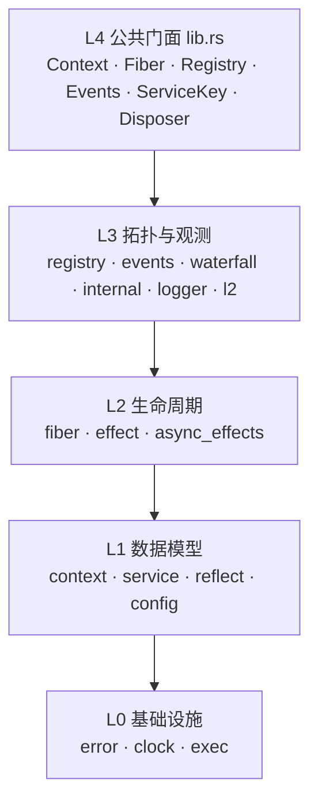
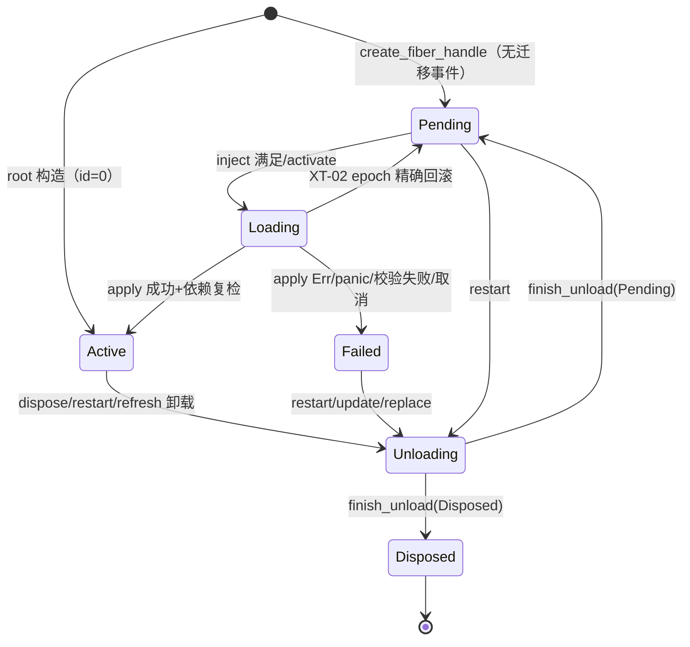

# Cordis Rust 内核架构全解

> **定位**：三件套第一篇，逐层解释 Rust 上游（v0.6.0）的结构、算法、锁纪律与不变量，并给出
> `CORE-001…051` 的实现证据。**证据约定**：`path:line` 相对 `reference/zeokeel-cordis-rust/`
> （如 `src/fiber.rs:1123`）；规范见 `spec/CORDIS-CORE.md`，设计意图见 `docs/DESIGN.md`，
> 隔离承诺见 `docs/KERNEL-ISOLATION.md`。
>
> **配套**：深度分析 [01](analysis/01-context-services.md) [02](analysis/02-fiber-lifecycle.md)
> [03](analysis/03-registry-events.md) [04](analysis/04-runtime-config-logger.md)
> [05](analysis/05-core-cases.md)；可行性 [GO-FEASIBILITY.md](GO-FEASIBILITY.md)；
> Go 设计 [GO-DESIGN.md](GO-DESIGN.md)。Go 侧为 v0 骨架（提交 `401c55f`，部分文件并行演进），
> 现状以 GO-DESIGN 的“已实现/简化”清单为准。

---

## 目录

[0 结论](#0-结论速览) · [1 分层](#1-分层与总体结构) · [2 Context](#2-context-层作用域容器) ·
[3 Service](#3-service-层服务身份与可用性) · [4 Fiber](#4-fiber-层六态状态机与生命周期) ·
[5 Effect](#5-effect-层时序撤销与取消) · [6 空间可组合性](#6-空间可组合性注入版本与刷新固定点) ·
[7 事件与 waterfall](#7-事件与-waterfall两条-lane) · [8 Registry](#8-registry运行时拓扑与静默) ·
[9 异步与取消](#9-异步模型与取消语义) · [10 隔离与 panic](#10-隔离与-panic-遏制边界) ·
[11 锁纪律](#11-锁纪律与并发不变量) · [12 不变量](#12-十二条不变量) · [13 CORE 映射](#13-core-001051-与实现映射) ·
[14 Rust 机制](#14-rust-专有机制清单) · [15 结论](#15-交给-go-移植的关键结论)

---

## 0. 结论速览

1. **两个正交维度**：时间可组合性 = 每个 context 变更加一个逆操作，fiber 持有有序 effect 列表，
   卸载按逆注册序执行；空间可组合性 = 组件声明 `inject`，运行时把 context 变化分类并自动激活/停用
   （`docs/DESIGN.md:26-82`）。
2. **五个内核对象**：Context、Service、Fiber、Effect、Events；Registry 是树级运行时索引
   （`src/lib.rs:58-106`）。
3. **一条有序 effect 列表**同时容纳 sync `Disposer` 与 async `AsyncDisposer`，跨 lane 逆注册序是硬
   语义（`src/fiber.rs:90-105,2446-2500`）。
4. **读 lane 宽松、注入门严格**：`lookup_for_injection` 额外要求 provider `Active`；两者绝不合并
   （`src/context.rs:682-706`，CORE-006/016）。
5. **激活是事务**：apply 返回 Ok 前注册的一切都在 effect 列表里；Err/panic/校验失败/依赖中途消失都
   逆序回滚，并用 `activation_epoch` 精确到本次尝试（`src/fiber.rs:1800-1963`）。
6. **生命周期互斥是 operation-level token**，不是线程身份；同 token 重入允许，其他调用一律
   `LifecycleBusy` 且不排队（`src/fiber.rs:3649-3838`，CORE-045）。
7. **卸载是两阶段迭代级联**：先 provider-before-dependent 地 begin，再逆 begin 序 drain
   （dependent-before-provider、child-before-parent），调用栈 O(1)（`src/fiber.rs:2502-3127`）。
8. **panic 遏制是默认，waterfall 是唯一 fail-closed 例外**；`panic="abort"` 被编译期拒绝
   （`src/lib.rs:48-56`，`src/waterfall.rs:102-115`）。

---

## 1. 分层与总体结构

### 1.1 五个内核对象

| 对象 | 表示 | 所有权 | 职责 | 证据 |
|---|---|---|---|---|
| `Context` | `Arc<ContextInner>` 句柄 | 每派生节点一个 inner | 作用域、查找起点、拦截、effect 入口 | `src/context.rs:37-57,122-124` |
| `Service` | `Arc<dyn Any+Send+Sync>` | 树共享 store，条目带 owner | 类型擦除值+可用性+schema+版本 | `src/service.rs:15,76-100` |
| `Fiber` | `Arc<Mutex<FiberData>>`+id | Registry 强持有 | 一次激活的状态/effect/生命周期 | `src/fiber.rs:148,152-220,332-336` |
| `Effect` | `Disposer`/`AsyncDisposer` | 注册它的 fiber | 逆序、单次、panic 隔离的撤销 | `src/effect.rs:9-79`，`src/async_effects.rs:36-78` |
| `Events` | 三张 `HashMap<String,Vec<..>>` | 每树一个 | listener/waterfall + internal bus | `src/events.rs:113-171`，`src/internal.rs:519` |

Registry 不是第六个对象，而是“`runtimes` 去重 + `fibers` 全局表 + 派生依赖索引 + 静默协调器”
四层合体（`src/registry.rs:402-482`）。

### 1.2 分层



依赖单向：L1/L2 不知道 L3 的注册表内部结构；L0 不依赖上层；内核不依赖异步运行时、HTTP、数据库、
时间库（`docs/KERNEL-BOUNDARY.md:94-127`，`Cargo.toml:60-68`）。

### 1.3 模块职责

| 模块（行数） | 职责与关键证据 |
|---|---|
| `context.rs`(2359) | `Context`/`ContextInner`、服务读写、effect 注册、事件转发、logger 入口（`src/context.rs:37-57,406-706,994-1204,1841-1956`） |
| `service.rs`(375) / `reflect.rs`(218) / `config.rs`(423) | `ServiceKey<T>`/`ServiceEntry`/`ServiceGate`/`Service` trait；`Accessor`/`ContextMeta`；`ConfigSchema`/`JsonConfigSchema`（`src/service.rs:15-329`，`src/reflect.rs:28-217`，`src/config.rs:22-377`） |
| `fiber.rs`(4347) / `effect.rs`(80) / `async_effects.rs`(733) | 六态状态机/级联/epoch/token；同步 Disposer；AsyncDisposer/drain frame/orphan（`src/fiber.rs:116-3947`，`src/effect.rs:9-79`，`src/async_effects.rs:19-629`） |
| `registry.rs`(3036) | `PluginRuntime`/`FiberSlots`/`DepIndex`/refresh/replace/dispose_all/quiescence（`src/registry.rs:70-2358`） |
| `events.rs`(673) / `waterfall.rs`(229) | 三张注册表/scope 过滤/sync+async 派发；continuation 中间件（`src/events.rs:19-673`，`src/waterfall.rs:43-229`） |
| `internal.rs`(787) | 9 个 typed hook + lifecycle bus + `contained()`（`src/internal.rs:12-102,177-301,459-763`） |
| `logger.rs`(555) / `clock.rs`(68) / `l2.rs`(150) | 日志服务与 exporter；可注入时钟；配额/能力自省/watchdog（feature）（`src/logger.rs:30-426`，`src/clock.rs:24-67`，`src/l2.rs:18-149`） |
| `exec.rs`(234) / `error.rs`(157) / `lib.rs`(106) | `block_on`/`join_all`/`BlockingExecutor`；17 个错误变体；crate 约束与 re-export（`src/exec.rs:26-234`，`src/error.rs:7-157`，`src/lib.rs:46-106`） |

---

## 2. Context 层：作用域容器

### 2.1 句柄与字段

`Context` 只有 `inner: Arc<ContextInner>`（`src/context.rs:122-124`）；Clone 是 Arc 克隆，同一个节点、
fiber、服务表。字段共享范围（`src/context.rs:37-57`）：`parent`（每节点，向上查找 scope/accessor/
meta/intercept）、`fiber`（继承）、`isolate`（派生 clone）、`intercepts`（派生清空，`intercept` 除外）、
`accessors`/`meta`（每节点独立）；`events`/`registry`/`logger`/`service_store`/`clock` **树共享**。

`root()`（`:128-193`）：新建 Events/Registry/Logger → 构造 root fiber（id=0、Active、RootPlugin、
SystemClock）→ 写 **weak 自引用**避免 Context↔FiberData 强环（`:178-184`）→
`registry.set_root_fiber`（root 不在 fibers 表但计入静默）→ `insert_service("logger",…)` 装入
内置 LOGGER（`:190-191`）。

### 2.2 派生规则

四个派生都是 `ContextInner` 的 copy-on-write，**父节点不变**（`src/context.rs:200-333`）：

| 派生 | isolate | intercepts | meta | 其余 |
|---|---|---|---|---|
| `extend()`/`child()` | 继承（clone） | 空 | 空 | 共享 events/registry/logger/store/clock/fiber |
| `isolate(name)` | clone + `name`→**新** scope id | 空 | 空 | 同上 |
| `isolate_labeled(name,label)` | clone + `name`→label 对应 id | 空 | 空 | 同上 |
| `intercept(name,config)` | 继承 | 仅 `{name: config}` | 空 | 同上 |
| `child_with_meta(meta)` | 继承 | 空 | 给定 meta | 同上 |

派生**不 fork 数据**，只改查找起点。`isolate` 每次分配新 id（`src/context.rs:241-245` →
`src/registry.rs:1034-1042`）；`isolate_labeled` 通过 `label_scopes` 复用（`src/context.rs:252-256` →
`src/registry.rs:1022-1032`）；两者共用一个计数器，不会撞号（`src/registry.rs:410-413`）。

### 2.3 scope、配置、元数据、accessor、clock

- `service_scope(name)` 从当前节点向根找 `isolate.get(name)`，返回**最近匹配**，无匹配 `None`，
  调用侧 `unwrap_or(0)`（`src/context.rs:296-306`）。存储键 `(scope,name)` 全树唯一；未 isolate 共享
  scope 0；**无祖先回退**（最近 scope 定义但不可用 → 读 None，CORE-014，`:672-680`）。
- `intercept`：每次产生只含一条映射的新节点；`resolve_config` 沿 parent 收集后 **reverse 成
  root→leaf**，head 最后（最高优先级）（`src/context.rs:314-333,1841-1877`）。只影响走
  `resolve_config` 的配置（logger、`Service::resolve_config`），**不影响 plugin 配置**——后者走
  `internal/config` waterfall（`spec/CORDIS-CORE.md:618-625`）。
- `meta`：`ContextMeta { entries: HashMap<&'static str, Arc<dyn Any+Send+Sync>> }`（`src/reflect.rs:70-73`）；
  `extend_meta` 派生新节点；读取沿 parent 链（`:193-217`）。
- `accessor`：`{get,set?}`（`src/reflect.rs:28-39`），注册为 fiber 的 `"ctx.accessor"` internal effect
  （`:122-177`）；查找沿 parent 链（`:179-191`）。get 先于服务且**命中即遮蔽**：即使返回 None 也不
  回退读 service（`src/context.rs:565-576`）；accessor 永远不满足 inject。
- `clock`：树级 `Mutex<Arc<dyn Clock>>` 槽（`src/context.rs:54-56`）；`set_clock` 只允许
  `fiber_id()==0`，写槽后遍历活 fiber+root 更新 `FiberData.clock`（`:345-402`）。

### 2.4 本层锁纪律

`service_store`/`accessors`/`clock`/`FiberData` 四种锁，共同规则：**锁内只做 map/字段操作，用户回调在
锁外**（`src/context.rs:688-694`，`src/reflect.rs:61-65`）。`insert_service` 的 store 锁只覆盖
`contains+insert`，`note_service_changed`、事件、effect 注册、refresh 全在锁外（`:498-539`）。详见 §11。

---

## 3. Service 层：服务身份与可用性

### 3.1 身份与双 lane

`ServiceKey<T>` 只携带名字（`src/service.rs:152-176`）：`{ name: &'static str, _marker: PhantomData }`。
**存储身份只有 `(scope,name)`**；`T` 只参与读取 downcast 与写入类型校验。同名不同类型的 key 是
“同一个槽、两个类型期望”：读错 None，写错 `ServiceTypeMismatch`；重复注册只看 `(scope,name)` →
`DuplicateService`（`src/context.rs:498-508`，CORE-004）。

| lane | 存储值 | `type_id` | API |
|---|---|---|---|
| sized/typed | `Arc<T> as Arc<dyn Any>` | `TypeId::of::<T>()` | `provide/get/require/set` |
| unsized/any | `Arc<ArcWrap<T>>` | `TypeId::of::<ArcWrap<T>>()` | `provide_any/get_any/require_any/set_any` |

`T: ?Sized` 允许 `ServiceKey<dyn Trait>`，这类 key 只能用 `*_any`（`Arc<dyn Trait>` 不能 unsize 成
`Arc<dyn Any>`，`src/service.rs:29-39`，CORE-032）；两 lane 的 type_id 不同，跨 lane 读写失败。

### 3.2 `ServiceEntry` 与三个可用性谓词

条目字段（`src/service.rs:76-100`）：`value`、`check`、`schema`、`owner`、`type_id`、`provider`
（Weak fiber）、`version`、`withdrawn`。Clone 只克隆 Arc/Value，因此可“锁内取 clone、锁外判定”。

```
is_available()               = !withdrawn && (check == None || check())     // 读 lane
is_available_for_injection() = is_available() && provider_is_active()       // 注入门
provider_is_active()         = provider None/upgrade 失败 → true(fail-open)
                               | provider Active → true，否则 false
```

（`src/service.rs:103-143`）。要点：① check 用 catch_unwind 包裹，panic→false；② provider 弱引用失效/
锁中毒→true（历史 entry 兼容，S-3）；③ 读 lane **不看** provider fiber 状态——provider Loading 时服务
仍可读（TS property-read 语义，`src/context.rs:682-694`）。

### 3.3 注册：`insert_service` 八阶段

`provide*` 全部收敛到 `insert_service`（`src/context.rs:445-541`）：

1. 构造 entry：type_id、`provider=weak(fiber)`、owner=fiber_id()、version=next_version()；
2. 解析 scope：`service_scope(name).unwrap_or(0)`；
3. **锁 store**：已存在→DuplicateService；否则 insert（锁只覆盖这里）；
4. `registry.note_service_changed(name)`：名字进 dirty 集合；
5. `emit_service(...,Some(value))`：internal/service 观察者（contained，不能 veto）；
6. 构造 disposer：锁内 remove→note_service_changed→emit None→refresh_dependents；
7. `register_effect_labeled(...,"ctx.provide")`：internal effect（不占用户 max_effects）；
8. `refresh_dependents()`：立即尝试激活依赖方。

**已知边界**：第 7 步若因 fiber 已 Unloading/Disposed 失败，entry **不回滚**（`:507-539`）；Go 应补
“注册失败→回滚 store”（GO-DESIGN §8）。

### 3.4 读取与严格查询

读取顺序固定为 **accessor → internal/get waterfall → 非严格 lookup**：

1. `find_accessor(name)` 命中 → 读 accessor（panic→None）并 downcast，命中即返回（`:565-576`）；
2. 否则 `waterfall_get(self,name,terminal=lookup(name))`：hook 可观察/覆盖返回值（`:572-574`，
   `src/internal.rs:702-726`）；
3. 对结果 downcast：类型不符→None（hook 返回错误类型也安全降级）。

`require`/`require_any` 把 None 映射为 `UnknownService(name)`（`:578-581,612-618`）。读 lane 永远不把
hook 虚拟服务/accessor 当成可注入服务。`lookup_for_injection` 在非严格 lookup 上额外要求
`provider_is_active()`（`:696-706`）；`service_available` 就是它的 is_some()（`:666-668`）；
`dependencies_ready` 要求每个名字命中严格查询（`src/fiber.rs:1081-1088`，CORE-006/016）。

激活成功后 `record_dep_versions` 用**非严格** lookup 记录 `(name,version)`（`:1091-1099`）；“仍满足”
用严格查询 **且** 版本相等（`dependencies_satisfied`，`:1101-1118`）。因此 provider 被 set、同名替换、
重启都会让依赖方卸载回 Pending 并重新激活（Cordis epoch，CORE-041）。

### 3.5 写入：`set` / `set_revertible`

`set(name,value)`（`src/context.rs:1993-2013`）：命中 accessor → 有 setter 则 `catch_unwind(setter)`，
false/panic→`AccessorWriteRejected`；无 setter→`AccessorReadOnly`；accessor 分支不经过 internal/set。
否则 `set_revertible(name,value)`（丢弃返回的 disposer，但 inverse 已挂 fiber）。

`set_revertible` 顺序不可交换（`src/context.rs:2024-2084`）：

1. `check_set_target`：无 entry→UnknownService；`owner != self.fiber_id()`→ServiceWriteForbidden
   （`:2107-2121`）；
2. `check_set_type`：`service_type_id(value)` 必须等于 `entry.type_id`，否则 ServiceTypeMismatch
   （`:2123-2148`，DESIGN I5）；
3. fiber 处于 Unloading/Disposed→InactiveEffect（**先拒绝再写**）；
4. 锁内取 `previous=entry.clone()`；
5. `internal/set` waterfall：terminal=`write_service`；hook 不调 next→空 Disposer，store 不变；
6. 构造 inverse：恢复 previous（无则 remove）；若恢复时 owner 正在卸载，恢复 entry 仍标 withdrawn；
   然后 note_service_changed+refresh_dependents；
7. `register_effect_labeled(inverse,"ctx.set")`+refresh_dependents()。

**代价**：每次成功写入都向 provider fiber 追加一个 inverse effect（XT-07），线性增长；高频更新应原地
改服务对象，或主动 Dispose 返回的 disposer。

### 3.6 `Service` trait / `ServiceGate` / withdraw

- `provide_service<S: Service>`：服务对象自带 `name/check/config_schema/resolve_config`；check 转
  `AvailabilityCheck`，config_schema 存入 entry（唯一公开 schema 写入点），走 sized lane
  （`src/service.rs:251-329`）。
- `ServiceGate`：`available: AtomicBool`+`watchers: Vec<Weak<ContextInner>>`；`set(bool)` 变化时对每个
  存活 watcher 调 `ctx.refresh()`（**全量**，`src/service.rs:196-249`）；watch 不去重（可容忍的幂等浪费）。
- `withdraw_owner_services(owner)`：一次锁内遍历全表，把 owner 的条目置 withdrawn=true，返回名字列表；
  调用点在 unload 起点，之后才 drain（`src/context.rs:2094-2105`，CORE-042）。

### 3.7 本层 panic 遏制

`is_available` 的 check 用 catch_unwind→false；`Accessor::read`/setter 用 contained→absent/
AccessorWriteRejected；`ConfigSchema::merge/validate` 用 contained→base/校验失败；
`Service::name/check/config_schema` 用 contained→占位值（`src/service.rs:103-143`，
`src/reflect.rs:55-65`，`src/config.rs:114-150`，`src/context.rs:1996-2007`）。

---

## 4. Fiber 层：六态状态机与生命周期

### 4.1 结构与句柄图

`FiberRef = Arc<Mutex<FiberData>>`（`src/fiber.rs:148`）；`Fiber{data:FiberRef}` 是句柄（`:332-336`）。
关键字段（`:152-220`）：`id/state`（Mutex 保护）、`plugin/inject/config/raw_config`、`effects/
deferred_async`（唯一有序列表+async 尾巴）、`parent/ctx/children`、`dep_versions`、
`activation_epoch/status_seq`、`lifecycle_owner/depth`、`pending_ops/settle_waiters`、
`dispose_requested/cancel_requested/last_activity_ms`。

句柄关系：`ContextInner.fiber`→强 Fiber；子 fiber 的 `ctx/parent`→强 Context；根 fiber 的 parent/ctx
是 weak 自引用；`children` 与父 effect 列表中的 ownership effect 捕获子 fiber 的 **Weak**
（`:1470-1543`）。这套“强父→弱子+根 weak 自链接”保证整图可 drop（CORE-033，
`src/context.rs:178-184,2344-2358`）。

### 4.2 六态状态机

`FiberState` 是 `#[non_exhaustive]` 六态枚举（`src/fiber.rs:116-125`）：



要点：`Failed` 是**稳定态**（refresh 只对 Pending 激活、对 Active 卸载，`src/registry.rs:2183-2198`；
只能经 restart/update/replace 复活）；`Disposed` 是**终态**（`transition` 见 Disposed 直接返回，
`src/fiber.rs:1129-1134`；`transition_if_epoch` 同样拒绝，`:1161-1166`；restart/update/replace 显式
`Err(Disposed)`，`:891-894,1010-1013,709-711`）；例外是 Disposed 仍有 deferred async cleanup 时重试
dispose 只排干 tail（A-9 retry，`:2362-2376`）；async 激活 future 被 drop 时 `AsyncActivationGuard`
用「state==Loading && epoch==self.epoch」只回收自己然后置 Failed（`:1286-1381`）。

### 4.3 迁移写入口与事件

`transition(data,next)`（`src/fiber.rs:1123-1143`）：锁→同态 no-op→当前 Disposed no-op→
`old=state`、`seq=status_seq.fetch_add(1)`（旧值，首个事件 seq=0）→`state=next`→快照 ctx→释放锁→
`publish_transition`。`transition_if_epoch`（`:1153-1179`）同锁检查 `state==expected &&
state!=Disposed && activation_epoch==epoch && state!=next`，通过才提交。

`publish_transition` 锁外顺序（`:1183-1208`）：① `emit_status(&fiber,old)`（raw hook，to 由 hook 自读，
**可能 torn**）；② `emit_lifecycle(&fiber,old,next,seq)`（快照 from/to/seq，订阅者不属于 fiber）；
③ 重新锁 data 取 registry 快照→`registry.notify_idle()`。

### 4.4 生命周期互斥：operation-level token

`NEXT_LIFECYCLE_TOKEN` 全局 AtomicU64（`:3656`）；`THREAD_TOKEN` thread-local 每线程惰性领一个
（`:3658-3661`）；`CURRENT_OP_TOKEN` thread-local 当前被 poll 的 async op token（`:3663`）；
`current_lifecycle_token()` op 非 0 用它否则用 thread token（`:3669-3676`）。

`claim_lifecycle(data,token)`（`:3743-3758`）在 FiberData 锁内：owner==0→写 token、depth=1；
owner==token→depth+=1（**重入**）；否则 `Err(LifecycleBusy)`（不阻塞、不排队）。`LifecycleGuard::drop`
（`:3694-3725`）只释放自己的槽。`begin_async_lifecycle`（`:3779-3795`）：嵌套 async op 内→复用；外层
同步 op→复用；否则领**全新 op token**。`WithOperationToken`（`:3803-3838`）每次 poll 安装、RAII 还原。

**为什么不是线程身份**：async 生命周期挂起时可能换 executor 线程；用 op token 后，任何线程的同步
dispose 都得到 LifecycleBusy（`:3727-3742`，CORE-045）。重入矩阵见 [02 §2.2](analysis/02-fiber-lifecycle.md)。

### 4.5 激活 epoch 与 XT-02

1. `begin_activation_epoch`：`activation_epoch=fetch_add(1)+1`（`:1800-1803`）；
2. 同步激活：`EpochFrame::enter(fiber_id,epoch)` 包住 `catch_unwind(apply)`，RAII 弹出（`:2141-2146`）；
3. 异步激活：`EpochFrameFuture` 在**每次 poll** 安装 frame，future 迁移线程仍正确（`:1868-1898`）；
4. `ACTIVATION_FRAMES: RefCell<Vec<(fiber_id,epoch)>>`（`:1810-1817`）；`current_activation_epoch` 取
   最内层匹配（`:1857-1866`）；`EpochFrame::drop` 用 `rposition` 精确移除（`:1833-1848`）；
5. 兜底：不在 frame 内注册的 effect 回退到 `activation_epoch` 最新值（`src/context.rs:1038-1048`）。

`push_effect` 把 `effect.activation` 打成当前尝试 epoch。**stale**（`activation_epoch != epoch`）按
effect.activation==epoch partition 后 drain，不改 state、不 remove_owner；**invalidated**（state ∈
{Disposed,Unloading}）取走全部 effects+deferred drain、children sweep、remove_owner
（`src/fiber.rs:1242-1279,1792-1924`）。`rollback_activation_to_pending` 只 drain 本尝试 effects，再用
`transition_if_epoch(Loading→Pending)` 原子提交，成功才 refresh_dependents（`:1935-1963`）。

### 4.6 激活管线

`activate_fiber`（`src/fiber.rs:2091-2345`）：① begin_operation（pending_ops++）→transition(Loading)；
② 锁内取 `plugin/config/raw_config/inject` 快照，锁外跑 internal/config waterfall；③ validate_config
（schema 失败→Failed+Validation）；④ `catch_unwind(apply/apply_async)`（panic→`PluginFailed("panic: …")`，
Err→保留结构化错误）；⑤ 成功：查 stale→查 invalidated→`dependencies_ready`（XT-02）→
record_dep_versions→transition(Active)→refresh_dependents()。

失败 `fail_fiber_sync/async`（`:1983-2079`）：set_error→`mem::take(effects)`→逆序 drain（sync inline，
async dispose_blocking 或进 deferred）→remove_owner→sweep_children→若未被 invalidated 则
transition(Failed)→refresh_dependents（CORE-028/029/038）。

### 4.7 生命周期入口

| 入口 | 关键顺序 | 证据 |
|---|---|---|
| `dispose()` | recover_parked→begin_operation→begin_lifecycle→unload(Disposed) | `src/fiber.rs:781-788,815-824` |
| `dispose_async()` | recover_parked_async→begin_operation→begin_async_lifecycle+with_operation_token→unload_async(Disposed) | `:793-811` |
| `restart()` | lifecycle→FinalizeGuard→begin_restart（Disposed→Err、Unloading→InactiveEffect、sync+async→AsyncPluginNeedsAsync、transition(Unloading)）→卸载到 Pending→依赖满足才激活；**激活错误被忽略** | `:844-911` |
| `update()` | internal/config→schema→internal/update（terminal 至多一次，替换值先校验）→需要时 restart（同一 token 重入） | `:962-1078` |
| `replace_plugin()` | lifecycle→FinalizeGuard→begin_replace（窗口+reindex）→rebind_single→catch_unwind(restart)→失败 restore+重载旧实现 | `:590-757` |
| `dispose_all()` | 恢复 parked→快照 fibers+root→逐个 catch_unwind(dispose) 收集 first_error/first_panic→prune→panic 优先 | `src/registry.rs:1409-1463` |

**`Ok(())` 不代表 Active**：restart/update/replace 的 post-reload 激活失败收敛为 fiber 级 Failed，错误在
`error_detail()`；只有 LifecycleBusy/校验类错误才返回 Err（`src/fiber.rs:838-843`，
`spec/CORDIS-CORE.md:554-559`）。

### 4.8 子 fiber 所有权与两阶段级联

三条并列线索（`src/fiber.rs:1457-1738`）：① `children: Vec<Weak<FiberData>>`（父→子弱，DFS/sweep）；
② 父 effect 列表中的 ownership effect（internal async，`owner_child=child_id`，cleanup 调
`child.dispose_async()`，busy 则打 dispose_requested）；③ 子→父强 Context+父→子弱 children。

注册顺序（`src/context.rs:1207-1354`）：父 Disposed→Err；**深度守卫**（沿 fiber parent 链，
`MAX_PLUGIN_DEPTH=256`，extend/intercept/meta 不耗预算）；分配 id/clock；register_fiber+
register_runtime_fiber；父状态须∈{Active,Loading,Pending}；push weak child；register_child_ownership；
最后 emit_plugin（此时 Pending、无 pending_ops）。动态记账上界：子自行 dispose 时
`detach_child_ownership` 摘除父 effect/children/诊断节点（`:1570-1639,2408-2422`）；ownership 摊销剪枝
阈值 1024（`:1457,1550-1562`）；每次 push 前 `retain(effect_is_live)`（`src/context.rs:1014-1020`）；
max_child_fibers 只数活 child、max_effects 只数 `!internal`（`:1249-1280,1021-1036`）。

**两阶段迭代级联**（`begin_cascade`，`src/fiber.rs:2840-3011`）：

- **Phase 1a 依赖 dependent（provider-before-dependent）**：`begin_frame(root,true)`→
  `take_effects_begin`（置 Unloading、取 effects+deferred、记 ctx、withdraw_owner_services+
  note_service_changed）；从 root 的 withdrawn 服务名出发 `dependents_of_services(frontier)` 取候选
  （索引不可用→回退）；候选按 fiber id 排序；对 `fiber_is_unready_active`（Active+Sync+!satisfied）
  begin_frame(candidate,Pending,false)；新 frame 的 withdrawn 扩展 frontier；有界轮数
  `fiber_count+2`；中途 replace 开窗口（epoch 变化）→全量扫描回退；非根帧对 Disposed/Unloading 直接
  `Ok(None)`（永不重复取 effect）；任一 begin 失败→`rollback_cascade`（已 begin 帧逆序 drain）。
- **Phase 1b ownership descendants**：显式 DFS 栈；`begin_frame(child,Disposed,false)`→extend；帧数超
  limit→log+break（剩余 child 可重试）。begin 序=DFS 前序 ⇒ 逆序 drain=子先于父；依赖 dependent 在
  child 之前 begin ⇒ 逆序为 child→dependent→provider。
- **Phase 2 逆序 drain**：dependents 逆序 drain_blocking（drain effects→sweep children→finish_unload），
  panic 记 first 只 log；root 最后 drain，panic 在状态落地后 resume_unwind。

**busy child / FinalizeGuard**：`sweep_children_*` LIFO 遍历；LifecycleBusy→request_child_dispose 打标
并继续；panic→contained、打标、记 first。`FinalizeGuard`（`:1774-1789`）在 restart/update/replace 的
所有退出路径上：若 `dispose_requested && state!=Disposed`→清 flag→`Fiber.dispose()`（同 token 重入），
外层再 catch_unwind（`:1752-1765`）。

---

## 5. Effect 层：时序、撤销与取消

### 5.1 数据结构

| 类型 | 定义 | 说明 |
|---|---|---|
| `EffectMeta` | `{label, children: Vec<EffectMeta>}` | get_effects 诊断树 |
| `EffectNode` | `{label, children, parent, owner_child}` | 树节点；owner_child 标记 ownership |
| `EffectKind` | `Sync(Disposer)`/`Async(AsyncDisposer)` | 双 lane |
| `FiberEffect` | `{kind, meta, activation, internal}` | epoch 标签+internal 记账 |
| `effects`/`deferred_async` | `Vec<FiberEffect>`/`Vec<AsyncDisposer>` | **sync/async 共享一条有序列表**+async 尾巴 |

（`src/fiber.rs:19-113,172-182`）。push 顺序=注册完成顺序；drain 用 rev()。

### 5.2 注册路径

| 入口 | 流程 | 位置 |
|---|---|---|
| `ctx.effect/effect_labeled` | 建 node→attach（挂栈顶）→state 检查（Disposed/Unloading→InactiveEffect）→push effect_stack→执行 setup()→弹栈→push_effect(internal=false)→返回 Disposer | `src/context.rs:1066-1096,1132-1146` |
| `ctx.effect_async*`/`effect_future`/`effect_stream` | 同上，返回 AsyncDisposer（future/stream 包装成 async cleanup） | `:1098-1128,1170-1183,1648-1740` |
| `attach_effect` | 不执行 body，把已有 Disposer 作为 user effect 挂到 fiber | `:795-802,935-966` |
| 内核记账/ownership | `register_effect_labeled(internal=true)`；ownership 节点 `EffectNode::new_owned("ctx.plugin",child_id)` | `:933-941`，`src/fiber.rs:1470-1544` |

`push_effect` 统一守卫（`src/context.rs:994-1051`）：①Disposed/Unloading→InactiveEffect；
②`retain(effect_is_live)` 剪已 dispose 条目；③max_effects 只数 `!internal`；④打 epoch 标签；⑤push。

### 5.3 逆序 drain 与顺序语义

统一模式：`for effect in effects.into_iter().rev()` 逐项执行；单个 cleanup panic 隔离并记录**第一个**
payload，全部跑完后在安全点重抛（CORE-011/030）；deferred_async 在所有普通 effect 之后 drain
（newest-first 存、从头取）。

| 变体 | 位置 | 行为 |
|---|---|---|
| `drain_effects_blocking` | `src/fiber.rs:2446-2466` | sync；async 用 dispose_blocking（BlockingExecutor/thread-park block_on） |
| `drain_effects_async` | `:2471-2500` | 逐个 await async cleanup（顺序确定，不并发） |
| `CascadeFrame::drain_blocking` / `AsyncFrameUnload::drain` | `:2575-2580,3210-3248` | drain effects→sweep children→finish_unload；非根帧取消安全版 |
| `CancelSafeUnload::drain` / `fail_fiber_sync_inner` / `rollback_epoch_effects` | `:3520-3563,1991-2008,1391-1416` | 取消安全重试；失败回滚 sync inline/async blocking 或 deferred；epoch 精确回滚 |
| `FiberData::drop` | `:234-330` | 最后安全网：逆序 sync cleanup；async 无 executor/unwinding→orphan |

**顺序性质**：①sync/async 混排→跨 lane 逆注册序（CORE-007/038）；②deferred 是更晚注册、更早 drain
的尾；③**嵌套 effect 的列表位置**：`run_labeled_effect` 先执行 body（其中嵌套 effect 已 push）再 push
自己→内层 effect 更靠前→fiber 级逆序 drain 先外层后内层（诊断树嵌套 ≠ drain 嵌套），Go 必须保持一致。

### 5.4 `Disposer` 状态机（sync）

`src/effect.rs:22-79`，`inner: Arc<Mutex<Option<Vec<Cleanup>>>>`：

```text
Armed(slot=Some) ──dispose()──► slot=None，从尾部 pop（逆注册序）执行
                                 │ 每个 callback catch_unwind，记录第一个 panic
                                 ▼
                           全部跑完 → resume_unwind(first_panic)（CORE-011）
重复 dispose：slot=None → no-op（单次/幂等）
Drop（仅最后一个 handle）：strong_count(inner)==1 时调用 dispose()，panic 被 contained+log
```

`Cleanup=Box<dyn FnOnce()+Send>`、`Effect=Vec<Cleanup>`（`:9-20`）；`is_disposed()`=slot None（`:55-58`）。

### 5.5 `AsyncDisposer` 状态机

字段：`inner: Arc<Mutex<Option<Vec<AsyncCleanup>>>>`+`state: Arc<DisposeState>`（`:74-78`）。
`DisposeState`（`:152-159`）：`done/cancelled/claimed: AtomicBool`+`waiters`；`is_settled()=
done&&!claimed`；`claim()` CAS(false→true) 取得 teardown 所有权并清 done/cancelled；`finish_drain()`
置 done 清 cancelled release+wake；`cancel()` 置 cancelled+done release+wake（cancelled 表示有 restored
cleanups 待重试）。

```text
Idle(claimed=false,done=false)
 ├─ dispose()/dispose_blocking() → claim 成功 → Draining（唯一 owner）
 │    ├─ 正常：逐项 await（first panic 记录）→ finish_drain → resume_unwind(first)
 │    ├─ future 被 drop（cancel）：CancelSafeDrain::drop 把未启动 cleanup 放回 slot、state.cancel()；
 │    │   in-flight cleanup 丢失（不可恢复，log）→ 下次 dispose 重新 claim 继续逆序跑
 │    └─ 列表空：finish_drain → no-op
 ├─ 他人正在 Draining（claim 失败）
 │    ├─ 本调用栈正处于该 disposer 的 drain frame（self-join）→ 立即返回
 │    └─ 普通 joiner → wait_done()；正常 finish → 返回；对方 cancelled → 重新 claim 重试
 └─ 已 settled（done&&!claimed）：重复 dispose no-op（cancelled 时除外）
```

- `dispose()` 循环（`:444-517`）：claim 失败先查 `drained_by_current_thread()`（self-join→return），否则
  `wait_done().await`；正常返回、cancelled 则 continue 重试；claim 成功后 take()，`CancelSafeDrain`
  包住列表，pop 逐项执行（`catch_unwind(cleanup)` 建 future+`catch_panic(DrainScopeFuture)` 逐 poll），
  完成后 finish_drain+resume_unwind。
- **drain frame/self-join（S-2/R2-1）**：thread-local `DRAIN_FRAMES: RefCell<Vec<usize>>`（`:80-92`），
  key=`&DisposeState` 地址（`:210-214`）；`DrainScopeFuture` 每 poll 进入 frame（`:122-139`）；
  `drained_by_current_thread()`=当前线程栈含该 key（`:216-223`）。**不是 thread id 判断**：同 worker 的
  无关 joiner 必须继续等。
- `dispose_blocking()`（`:553-587`）：先 self-join 短路；settled&&!cancelled 才 no-op；否则
  `block_on_unit(clone.dispose())`——join 语义：阻塞到全部 cleanup 真正完成。
- `CancelSafeDrain::drop`（`:237-266`）：remaining 非空且 slot 空→放回（保序）；state.cancel()；
  in-flight future 无法恢复，log。`discard()`（`:519-534`）：取走 cleanups 丢弃+finish_drain（R3-A4）。
- `Drop`（`:598-629`）：cancelled→只 log；最后一个 handle 且未 disposed 且未 unwinding→contained
  dispose_blocking()；unwinding→取走丢弃+log。

### 5.6 deferred、orphan 与剪枝

- fiber 级 deferred：取消/同步失败时 AsyncDisposer 直接挪进 fiber 的 deferred_async（不在 disposer
  内部），由下次 fiber dispose/drain 处理（`src/fiber.rs:2471-2500`）。
- orphan（XT-01，`src/async_effects.rs:268-434`）：`ORPHAN_CAPACITY=256`；`ORPHANS:
  Mutex<Vec<AsyncDisposer>>`；3 个原子计量。仅在 `FiberData::drop` 无法安全跑 cleanup 时调用：队列未满
  入队；满/中毒则 `mem::forget`（绝不就地 Drop）+计数；从不阻塞、从不 unwind。公开 API：
  `orphan_async_cleanups_pending()`、`orphan_async_cleanup_count()`、
  `orphan_async_cleanup_failure_count()`、`drain_orphan_async_cleanups()`。
- 剪枝：`push_effect` 每次注册前 `retain(effect_is_live)`（`src/context.rs:1014-1020`）；ownership 摊销
  阈值 1024（`src/fiber.rs:1457,1550-1562`）；`detach_child_ownership`（`:1570-1639`）在子自行 dispose
  后摘除父 effect/children/诊断节点，随后锁外 `discard()`。`get_effects()` 只返回仍持有资源的顶层节点，
  子节点仅当与 live 中某节点 `Arc::ptr_eq` 才保留（C3，`:372-396`）。

---

## 6. 空间可组合性：注入、版本与刷新固定点

### 6.1 注入门与版本

```
dependencies_ready(ctx,deps)      = ∀name: lookup_for_injection(name).is_some()
dependencies_satisfied(fiber,ctx) = ∀name: lookup_for_injection(name)
                                    && recorded_version(name)==entry.version
```

（`src/fiber.rs:1081-1118`）。前者用于 Pending→Loading，后者用于 Active→Unloading；二者都要求
provider Active（严格），因此 Failed/未 Active 的 provider 不能激活依赖者（CORE-005/016）。

- 全局单调版本 `SERVICE_VERSION: AtomicU64` 初值 1，`next_version()=fetch_add(1)`
  （`src/service.rs:17-27`）；entry 注册与每次 write_service 取新版本。
- 依赖记录用**非严格** lookup `(name,version)`（`src/fiber.rs:1091-1099`）；“仍满足”用严格查询+版本
  相等（`:1101-1118`）。因此 provider 被 set、同名替换、重启都让依赖方回 Pending 并重新激活
  （Cordis epoch，CORE-041）。

### 6.2 refresh 固定点

同步 `refresh_all_impl(full)`（`src/registry.rs:2123-2205`）：重入熔断 `begin_refresh` CAS 0→1，失败
仅置 `refresh_dirty=true` 返回，外层循环消费（`:2094-2104`），`RefreshGuard::drop` 所有退出路径归零
（`:670-685`）；最多 64 轮；每轮取候选（full→全量快照；否则 `refresh_candidates()`）→对每个 fiber 快照
`(ctx,plugin,config,deps,recorded)`（锁外释放）→Sync+Pending+ready→activate；Sync+Active+!satisfied→
`unload_contained(Pending)`；async fiber 一律跳过；有进展或 dirty 则继续。异步
`refresh_all_async_impl`（`:2269-2357`）先恢复 parked（≤8 轮），其余同上但 Pending 分派
activate_fiber_async、Active 不满足时 unload_contained_async。`find_unready_active`（`:2227-2252`）扫描
第一个 Active 且依赖不满足的 **sync** fiber。`unload_contained(_async)`（`src/fiber.rs:3441-3508`）也
begin_operation+claim lifecycle slot；busy 时本轮跳过（false），后续 refresh 重试；cleanup panic 被遏制。

**用户 `ctx.refresh()` 走全量**（`src/registry.rs:2114-2121`），保证 availability gate 翻转总被看到；
内部路径用 dirty 候选快路径。**sync refresh 不 recovery**（见 §9.4）。

### 6.3 反向依赖索引 S1–S4

```text
DepIndex {
  inject_by_fiber:       HashMap<u64, &'static [&'static str]>,  // fiber → inject 声明
  dependents_by_service: HashMap<&'static str, HashSet<u64>>,    // 服务名 → 依赖 fiber 集合
  runtime_by_fiber:      HashMap<u64, PluginKey>,                // fiber → runtime
}
```

（`src/registry.rs:560-571`）。**纯派生状态，永不作为可用性权威**；决定仍由 `lookup_for_injection`+
`dependencies_ready/satisfied` 做，索引只缩小候选集（superset filter，`:454-458`）。

维护：fiber 入表 `index_fiber_deps`（`:1756-1776`）；销毁 `unindex_fiber`（`:1573-1589`）；绑/迁
runtime（`:1799-1800,1278`）；单 fiber 换实现先开窗口→改 inject/plugin→reindex→关窗口
（`src/fiber.rs:529-560,691-757`）；服务出现/移除/set/撤回 `note_service_changed`
（`src/context.rs:511,526-539,2078-2082,2161-2193`，`src/fiber.rs:2389-2404`）；状态变化只
refresh_dependents()。

窗口/代数：`dep_index_begin_window()` 同时 windows+=1、epoch+=1，RAII drop 减窗口
（`:1520-1524,575-585`）；`dep_index_ready()=!broken && windows==0 && try_lock().is_ok()`（`:1531-1537`）；
`mark_dep_index_broken()`（poison/元数据不可读→永久全量扫描，`:1541-1543`）；**顺序不变量 P2-1**：窗口
必须在 inject 变更**之前**打开，否则并发 cascade 可能读到“可信索引+旧反向边”，漏掉刚变成 dependent 的
fiber（`src/fiber.rs:534-541`）。

### 6.4 cascade 前沿与 gate 翻转

`begin_cascade` Phase 1a 每轮：从 root 的 withdrawn 名字出发 `dependents_of_services(frontier)` 取候选
（`src/fiber.rs:2866-2901`）；每个候选重做 `fiber_is_unready_active`（Active+sync+!satisfied），绝不
只看索引（`:2888-2895`）；候选按 fiber id 排序（`:2883`）；新 frame 的 withdrawn 并入 frontier，直到
不动点或 fiber_count+2；索引不可信/中途失效→`find_unready_active` 全量扫描（`:2958-2984`）；debug
可选交叉校验（`:2920-2957`）。

`ServiceGate::set`（`src/service.rs:216-228`）对每个存活 watcher 调 `ctx.refresh()`（全量），依赖方
gate 关闭时卸载到 Pending、重开时重新 apply（CORE-006）。provide_checked 本身不刷新
（`src/context.rs:414-431`，CORE-013）；provide_gated 通过 gate 自动刷新。

### 6.5 provider-withdrawal order

fiber 卸载顺序固定：transition(Unloading)→`withdraw_owner_services(owner)`（owner 的 entry 全置
withdrawn）→依赖方失活（refresh/cascade）→再 drain 自己的 effect（provide disposer 才 remove entry+
emit None）（`src/fiber.rs:2362-2404`，`src/context.rs:526-540`，CORE-042）。因此依赖方 cleanup 在
binding 仍存在但 withdrawn 时运行，读 get 得到 None，不会观察到“值还在但提供者已死”。

---

## 7. 事件与 waterfall：两条 lane

### 7.1 Events 结构与 listener 记录

三张独立 `Mutex<HashMap<String,Vec<…>>>`：listeners、waterfall_listeners、async_waterfall_listeners；
一次派发只锁对应 map 取快照，之后无锁执行（`src/events.rs:165-171`）；next_id: AtomicU64 共用，
Disposer 按 id 精确移除。

| `Listener` 字段 | 语义 |
|---|---|
| `id`/`owner` | 总线内唯一 / 注册时 fiber_id()（remove_owner 按此清空） |
| `body` | `Sync(ListenerFn)`/`Async(AsyncListenerFn)`，分开存、分派 |
| `scope` | 注册时 `inner.isolate.clone()` 快照 |
| `global`/`once`+`called` | 绕过 scope / 一次性（called.swap 并发至多一次） |

（`:119-128`）。WaterfallEntry/AsyncWaterfallEntry 有 id/owner/callback/scope/global，**没有 once**
（`:130-146`）。`ContextScope=HashMap<&'static str,u64>`（`:76-77`）。

### 7.2 scope 过滤 = 映射相等

`passes(global,listener_scope,dispatch_scope)`（`src/events.rs:200-209`）：global→放行；
dispatch_scope==None（直接调 Events::*）→放行；否则**映射相等**才放行。是“isolate map 相等”不是
“子树遍历”：root 与 root.isolate("x") 是两个 scope，互不收事件（CORE-019）。scope 是注册时快照，
之后子 context 的 isolate 变化不影响已注册 listener；Context 层派发始终传 `Some(&inner.isolate)`
（`src/context.rs:1785-1835`）。

### 7.3 注册与 owner 回收

`ctx.on(name,l)`→on_with(...)→on_with_options(...)：owner=fiber_id()；(callback,options)=
resolve_listener(...)（internal/listener bail hook 可替换）；wrap_once_listener；Events::add_listener；
adopt_listener 把 disposer 注册为 fiber-owned internal effect（`src/context.rs:1480-1544`，
`src/events.rs:559-673`）。`on_async/on_async_with` 直接 add_async_listener，**绕过 internal/listener
hook**（XT-06），options 固定 `{prepend,global:false,once:false}`，仍是 fiber-owned。waterfall 注册同样
fiber-owned，公开 API 默认无 prepend/global/once。

owner 回收三道防线：正常 unload `finish_unload→events.remove_owner`；激活失败/取消回滚
`fail_fiber_*`、`discard_activation_effects*`、`rollback_activation_to_pending*` 显式 remove_owner；
兜底 `FiberData::drop` 时 catch_unwind(remove_owner)（`src/events.rs:275-291`，
`src/fiber.rs:1269,1278,2014,2062,234-246`）。

### 7.4 同步与异步派发

同步四个函数结构相同（`src/events.rs:293-371`）：emit_dispatch→listener_snapshot（克隆 Vec、释放锁）
→过滤 passes→只处理 Sync→once 判断→call_sync。`emit` 忽略返回值；`bail` 遇 into_bail() 的 Some 立即
返回（第一个非 null/false 的 Bail）；`parallel` 与 emit 等价；`serial` 复用 bail。`call_sync` 用
catch_unwind，panic→记录并当作 Continue（CORE-031）。once 用 `called.swap(true)`，执行后 remove
（`:304-310`）。Bail(Null)/Bail(false) 不 bail（`:19-38`，CORE-018）；派发期间新增 listener 不参与本轮，
被移除者仍可能在本轮快照里被调用一次。

异步（`:373-468`）：`parallel_async` 先 emit_dispatch(Parallel)，按注册顺序 inline 跑 sync listener，
async body 在 catch_unwind 中**构造 future** 后 push 进 pending，once 在构造后立即移除；最后
`exec::join_all` 手写轮转 poll（每轮按输入顺序各 poll 一次），Bail 被忽略。`serial_async`：sync inline、
async 构造后立即 await，严格注册顺序，遇 bail 停止。两条 lane 互斥：sync 派发绝不 poll async
listener；async 派发会 inline 跑 sync listener（`spec/CORDIS-CORE.md:404-457`）。

### 7.5 internal：9 个 typed hook + lifecycle bus

| # | event | 签名要点 | 语义 |
|---|---|---|---|
| 1 | internal/plugin | `Fn(&Fiber)` | fiber 创建后、激活前广播 |
| 2 | internal/status | `Fn(&Fiber,FiberState /*old*/)` | 每次真实迁移；to 自读可能 torn |
| 3 | internal/config | waterfall `Fn(&Fiber,Value,&ConfigNext)->Value` | 每次激活与 update |
| 4 | internal/service | `Fn(&Context,&str,Option<&ServiceValue>)` | provide/remove 观察 |
| 5 | internal/update | waterfall `Fn(&Fiber,Value,bool,&UpdateNext)` | terminal 提交 raw+restart；panic=allow |
| 6 | internal/get | waterfall `Fn(&Context,&str,&GetNext)->Option<ServiceValue>` | None=服务缺失，不是 skip |
| 7 | internal/set | waterfall `Fn(&Context,&str,&ServiceValue,&SetNext)->bool` | 返回是否已写 |
| 8 | internal/listener | bail `Fn(&ListenerRequest)->Option<ListenerOverride>` | 第一个 Some 生效 |
| 9 | internal/dispatch | `Fn(&DispatchInfo)` | 仅最外层用户事件；递归门闩；internal/ 前缀跳过 |

（`src/internal.rs:12-22,177-301,599-763`）。**lifecycle bus**（不是第 10 个 internal/*）：
`LifecycleHookDyn=Fn(&Fiber,from,to,seq)`，锁内快照 from/to/seq 再锁外投递；订阅**不属于 fiber**、不随
安装 fiber 卸载（`src/internal.rs:506,615-633`，`src/context.rs:2252-2268`）。LifecycleEvent 是
`#[non_exhaustive]`，字段 fiber_id/name/from/to/seq；seq per-fiber 单调（0 起、可乱序到达，按
(fiber_id,seq) 重排，`src/internal.rs:243-273`）。

两种所有权：`Context::on_internal_*` 写共享 bus+注册 fiber internal effect（随 fiber 卸载）；
`InternalBus::on_*` 由调用方自持 Disposer（必须手动 dispose）；on_lifecycle 非 fiber 绑定。两者写同一
有序 hook 列表（`src/internal.rs:459-500`，`src/context.rs:2200-2337`）。

### 7.6 waterfall continuation

`WaterfallNext{remaining:Arc<[Fn]>, args:Arc<[Value]>, terminal}`（`src/waterfall.rs:56-75`）：

```text
next(): match remaining.split_first():
  Some((listener,rest)) => next=WaterfallNext{rest,args,terminal}
                           catch_unwind(listener(args,&next)) → panic: log+resume_unwind
  None                  => (terminal)(args)        // sync 不在 catch_unwind 内
```

链顺序=注册顺序：第一个注册的是最外层 middleware（洋葱模型，CORE-020）；next() 可多次调用（每次从
self.remaining 重新 split，剩余链与 terminal 重跑）；terminal() 跳过剩余链直接跑链尾；args 对所有
middleware 同一份（只能改写返回值）。async 版 next() 返回 BoxFuture，顺序/洋葱模型一致（`:161-184`，
`src/events.rs:493-520`）。

**panic 策略**：waterfall 是唯一 fail-closed 例外——记录后中止整条链并重抛；剩余 middleware 与
terminal 不执行（`src/waterfall.rs:102-115`）。原因：waterfall 常被用作策略/鉴权，把 panic 降级为 Null
会把“策略失败”变成“允许”。注意 sync terminal 不在 catch_unwind 内（`:117`），仍 fail-closed 但缺日志；
async 整条 future 被 exec::catch_panic 包裹。

### 7.7 两条 lane 对比

| 维度 | bail lane（emit/bail/parallel/serial） | waterfall lane |
|---|---|---|
| 控制流 | listener 返回值决定是否停链 | 是否调用 next 决定是否继续 |
| 停止方式 | Bail(非 null/false) | 返回而不调用 next |
| 结果 | 首个 bail 值/忽略（emit） | 最外层 middleware 返回值/terminal 值 |
| 中间件能力 | 无（不能改写后续结果） | 洋葱模型，可改写返回值、可重复 next |
| panic | 遏制为 Continue | 记录并重抛（fail-closed） |
| 类型 | EventResult | 无 Bail 类型，直接 Value |

---

## 8. Registry：运行时拓扑与静默

### 8.1 PluginKey 与 dedupe

`PluginKey::Type(TypeId)`（plugin_typed/inject 用）与 `PluginKey::Named(&'static str)`（Plugin::name()
默认）（`src/registry.rs:120-128`）。ctx.inject 用 `TypeId::of::<Injected<F>>()`，每次 inject 调用是独立
runtime（FIX-20，`src/context.rs:1446-1477`）。C2 元数据遏制：name/key/inject/config_schema panic 时
分别降级为 `"<panicked plugin>"`/`Named("<panicked plugin>")`/`&[]`/None，记录 error 且绝不 unwind 出
ctx.plugin（`src/registry.rs:205-338`；所有 key-panic 插件共享同一 runtime，keys/replace/delete 无法
单独寻址）。dedupe：`register_runtime_fiber` 用 `runtimes.entry(key).or_insert_with(...)`；最后成员被
移除时 `unregister_runtime_fiber` 删表，另有 `prune_empty_runtimes` 兜底（`:1780-1805,1823-1890,
1920-1938`）。

### 8.2 FiberSlots 与快照语义

`PluginRuntime.fibers` 是 tombstone 槽位（`src/registry.rs:484-558`）：slots: Vec<Option<Fiber>> 保留
插入顺序、positions: HashMap<u64,usize>、live: usize；删除 O(1) 置 None；`slots.len()>live*2+64` 时
compact()（均摊 O(1)）。动机：旧 Vec+retain 在 5000 fibers 共享 runtime 的 fanout dispose 下是 O(n²)
（实测 ~2.2s，`:484-490`）。

size/get/has/keys/values/entries/for_each/fibers/fiber_count 各只锁一个结构，跨调用可短暂不一致；需要
一致视图用 is_idle()/when_idle()（`:786-1512`，CORE-022/049）。for_each 先 entries 再锁外回调
（`:1494-1503`）。fibers() doc 声称包含待 prune 的 disposed fiber，但实现 finish_unload 就立即移除
（`src/fiber.rs:2421-2432`）——**注释与实现不一致**，以 live 表为准。

### 8.3 replace 的原子流程

**阶段 A rebind_runtime(old,kind)**（`src/registry.rs:1334-1403`）：kind.key()/name() 先求值（元数据
panic 已 C2 遏制）；锁 runtimes：remove(old)，不存在→InvalidPlugin；若 new_key 已有 runtime 则 merge，
否则新建；释放锁后对每个旧 fiber 快照 `(Fiber,旧 kind,旧 runtime_key)` 形成 RebindUndo；push 进目标
runtime；每个 fiber swap_plugin(kind)（开/关索引窗口+reindex）+写 runtime_key；失败→undo_rebind；
heal_disposed_registrations（迁移窗口内被并发 dispose 的 fiber 不能被新 runtime 持有，D-1）。

**阶段 B 逐 fiber reload**（`:1088-1165`）：catch_unwind(restart())；Ok(Ok)→下一个；Ok(Err)→
rollback_replace；Err(payload)→`PluginFailed("… reload panicked: …")` 后回滚。

**阶段 C 回滚**（`:1167-1228,1287-1332`）：undo_rebind 恢复 runtime 表与 fiber 绑定；对 0..reloaded+
失败 fiber 用**旧实现** restart_contained；replace_rollback_result 决定返回原错误/Rollback；
reloaded==0 或 rollback error 是 LifecycleBusy 时返回原错误（结构性恢复已完成）。

**语义要点 XT-05**：Ok 只表示 swap/rebind/reload 机器跑完；reload 的 activation 失败会让 restart() 收敛
为 Ok(())、fiber 落 Failed，runtime 保持绑定新实现、**旧实现不恢复**；只有 LifecycleBusy/校验类错误才
触发阶段 C（`:1101-1129`）。

### 8.4 dispose_all 与 quiescence

`dispose_all`（`src/registry.rs:1409-1463`）：①recover_parked_unloads_blocking；②快照 fibers 逐条
catch_unwind(dispose) 记录 first_error/first_panic、永不中断；③root 同样；④prune_empty_runtimes；
⑤panic 优先（error 先 log 再 resume_unwind 第一个 panic）；只有 err→Err；只有 panic→重抛；否则 Ok。
Ok 后 registry 空且 idle；Busy fiber→Err(LifecycleBusy) 且可能留未清理 fiber（调用方重试，XT-10）。

Quiescence 字段（`:402-482`）：pending_registrations、registration_owners: HashMap<ThreadId,usize>、
idle_waiters、parked_unloads、active_unloads、recovering_parked。

- `is_idle()`（`:871-873`）+`is_idle_excluding_with_total(own,total)`（`:888-917`）：total-own==0（严格版
  own=0），且所有 fiber+root state∉{Loading,Unloading} 且 pending_ops==0。
- 注册窗口：Context::plugin* 在 create_fiber_handle **之前** begin_registration()
  （`src/context.rs:1379-1433`），guard 覆盖到 activation；RegistrationGuard::drop 按**创建线程**释放
  owner（跨线程 drop 也不错扣，C4）+pending--+notify_idle（`src/registry.rs:694-715,1940-1969`）。
- when_idle() 的 recovery-aware 循环（`:963-1008`）：每轮在同一把 owner-map 锁内取 (own,total)（防
  TOCTOU）；idle 且无 parked→return；有 parked 时 active unload→等，否则 recover_parked_unloads_async
  后重试；否则 wait_idle_or_recoverable()；轮数上限 fiber_count+8（≥16），超限 log 后回退纯可恢复等待
  （不 hang）。
- **边界**：两线程注册窗口互相 when_idle() 会死锁（不检测环）；apply 内不可同步等待 idle（自己
  pending_ops>0 会等自己，XT-04）。

---

## 9. 异步模型与取消语义

### 9.1 Future / executor / 桥

`BoxFuture<'a,T>=Pin<Box<dyn Future<Output=T>+Send+'a>>`（`src/exec.rs:26-27`）；block_on 是 thread-park
极简 executor，只推进自我唤醒的 future（`:49-98`）；yield_now 首次 Pending+自唤醒、第二次 Ready
（`:100-123`）；join_all 每轮按输入顺序各 poll 一次、保序返回（`:125-161`）；catch_panic 用
catch_unwind 包住每次 poll（`:163-187`）。

`BlockingExecutor{fn block_on(&self,BoxFuture<'static,()>)}`；set_blocking_executor 首次安装胜（OnceLock
失败返回 false）（`:202-234`）。使用点：Fiber::dispose/restart/update、AsyncDisposer::dispose_blocking
等同步卸载边，用于驱动 deferred async cleanup（CORE-034）。FiberData::drop 用 has_blocking_executor()
判断：无 executor 或正在 panicking 时**跳过** async cleanup（进 orphan 队列），只在有 executor 时于
Drop 内 dispose_blocking（`src/fiber.rs:234-330`）。

### 9.2 取消：cancel() 与 future drop

- **协作取消**：Fiber::cancel() 置 cancel_requested；Context::checkpoint() 读 flag，true→
  Err(Cancelled)；内核从不抢占/强杀，长任务必须自行 checkpoint 并沿正常 failure/rollback 退出
  （CORE-050，`src/fiber.rs:480-495`，`src/context.rs:713-730`）。
- **真正的中止原语是 drop future**（超时/select/host cancel）。两个收尾器：AsyncActivationGuard（激活
  future 被 drop 时回收自己 epoch 的 effect，必要时置 Failed）与 CancelSafeUnload/park_cancelled_frame
  （卸载 future 被 drop 时完成 teardown 或 park）。

### 9.3 取消恢复（S-1）与 fiber 卸载（A-9）

AsyncDisposer 的 CancelSafeDrain::drop 把**尚未启动**的 cleanup 放回 slot（保序），state.cancel()；
**已经 await 的 in-flight cleanup future 无法恢复**（Rust 无 cancel-safe await），只能 log
（`src/async_effects.rs:237-266`）。下次 dispose/dispose_blocking 重新 claim 继续逆序执行；
dispose_blocking 是明确的“重试恢复项”入口（`:553-587`）。

dispose_async 被取消时：sync cleanup 继续 inline；未启动的 async cleanup 放进 fiber 的 deferred_async
（不丢、不跑）；fiber **完成 teardown** 并落到目标态（dispose→Disposed，refresh/restart→Pending）；
重试 dispose_async 先排干 deferred（`src/fiber.rs:3520-3563`）。

### 9.4 parked cascade 恢复（F1/F4/F5）

非 root cascade 帧被取消时不能就地完成（可能丢最后一个 FiberData 引用，而 deferred cleanup 需要
reactor），因此 park_cancelled_frame 把 fiber 保持 Unloading、sync cleanup inline、async 全推 deferred、
registry.park_unload(&data,target)（`src/fiber.rs:3144-3195`）。

- **恢复入口**：dispose/dispose_async 前置、dispose_all、refresh_all_async_impl（≤8 轮）、when_idle
  recovery 循环（`src/registry.rs:1411`，`src/fiber.rs:963-996,2269-2282`）。
- **单 recoverer**：begin_recovery/end_recovery 用 recovering_parked，RecoveryGuard::drop 释放并
  notify_idle（`src/fiber.rs:2595-2613`，`src/registry.rs:2061-2070`）。
- **活跃 unload 排斥**：has_active_unload() 为真时 recovery 返回 0（避免嵌套 blocking）。
- **有界**：轮数上限 fiber_count+2；ReparkGuard/RecoveryBatch 保证取消恢复不丢帧。
- **sync refresh 故意不 recovery**（`src/registry.rs:2123-2132`）：可能运行在 reactor 线程，同步 drain
  async cleanup 会死锁；恢复留给 awaitable 入口。
- **边界**：取消落在**正在执行**的 async cleanup 上时该 in-flight future 不可恢复；但 fiber 不会永久
  Unloading；is_idle() 严格 false 直到 recovery 跑完。

### 9.5 orphan 队列

见 §5.6。角色：FiberData::drop 在无 BlockingExecutor 或线程 unwinding 时把 async cleanup 交有界孤儿
队列而非静默丢弃；sync cleanup 仍 inline（`src/async_effects.rs:268-434`）。

---

## 10. 隔离与 panic 遏制边界

### 10.1 L1–L4

| 层 | 机制 | 买到什么 | 成本 |
|---|---|---|---|
| **L1** 进程内遏制（本 crate） | unwind 边界+回滚+Drop 规则+锁内不跑用户代码 | panic 不扩散；故障归因到 fiber | 0 |
| **L2** 线程级监督 | 心跳、deadline、协作取消、资源计量 | 定位/降级/优雅重启；**不能杀线程** | 低-中 |
| **L3** 进程隔离 | 子进程+IPC+SIGKILL+rlimit/cgroup/seccomp | abort/SEGV/UB/OOM/死循环可恢复 | 高 |
| **L4** WASM 沙箱 | wasmtime/wasmer+fuel/时间/内存上限 | 第三方代码安全边界 | 高 |

（`docs/KERNEL-ISOLATION.md:201-211`）。可信同源代码→L1+L2 足够；第三方/可被攻破→必须 L3/L4。

### 10.2 遏制矩阵

| 边界 | 机制 | 降级 | 证据 |
|---|---|---|---|
| sync/async apply | catch_unwind | 激活失败、回滚、Failed；不穿出 ctx.plugin | `src/fiber.rs:2141-2196` |
| cleanup | 逐个 catch_unwind | 其余继续；drain 完重抛首个；回滚中只记录 | `src/effect.rs:36-58`，`src/async_effects.rs:444-517` |
| refresh/retire 卸载、父 sweep 子 | unload_contained / 逐 child catch_unwind | panic 记录，provider 仍到目标态；继续 sweep | `src/fiber.rs:3441-3471,1669-1738` |
| replace/reload | catch_unwind(restart) | PluginFailed("… reload panicked: …")+回滚 | `src/registry.rs:1101-1129` |
| Plugin 元数据、internal hook、accessor、schema、check、logger exporter | contained / catch_unwind | 占位值/continue/absent/validation failure/base/false | `src/registry.rs:205-338`，`src/internal.rs:83-102`，`src/reflect.rs:55-65`，`src/config.rs:114-150`，`src/service.rs:103-111`，`src/logger.rs:232-289` |
| dispose_all | 逐 fiber recover | panic 优先，所有 fiber 都尝试过 | `src/registry.rs:1409-1463` |
| listener | sync catch_unwind；async 构造/poll 分别 catch_panic | 记录，继续 | `src/events.rs:83-100,397-413,444-456` |
| **waterfall middleware** | **记录后 resume_unwind** | **唯一 fail-closed**：剩余链与 terminal 不执行 | `src/waterfall.rs:102-115` |

### 10.3 不可遏制与编译期强制

不可遏制：panic="abort"、栈溢出、OOM/allocator abort、process::abort()/exit()、插件 unsafe UB/SEGV、
死循环/死锁、线程/fd 泄漏、取消撞在飞的 async cleanup、跨线程环形注册等待
（`docs/KERNEL-ISOLATION.md:110-126,213-257`）。编译期/CI：`#![forbid(unsafe_code)]`（`src/lib.rs:46`）；
`#[cfg(panic="abort")] compile_error!`（`:48-56`），CI 反证该构建必须失败；release overflow-checks=true、
clippy await_holding_lock=deny/mutex_integer=deny（`Cargo.toml:36-58`）；MAX_PLUGIN_DEPTH=256；深依赖链
卸载迭代化（栈 O(1)）。

---

## 11. 锁纪律与并发不变量

### 11.1 锁清单与顺序

| 层 | 锁 | 顺序约束 |
|---|---|---|
| L1 | FiberData（每 fiber 一把） | 先于 L2；持锁时**不调用 embedder 代码** |
| L2 | children、dep_versions、settle_waiters、EffectNode、Registry.quota | L1 内获取，不反向 |
| L3 | Disposer.inner、AsyncDisposer.inner、DisposeState.waiters | 在 fiber 锁外（drain 前已 take 列表） |
| R | Registry 各结构独立锁 | dep_index 是**叶子锁**：持它时不得再取 fibers/runtimes/fiber.data（`src/registry.rs:454-458`） |
| C | ContextInner.service_store/accessors/clock/meta | 不在 fiber 锁内获取 |
| E | Events 监听器 map | 回调前释放锁（snapshot） |

### 11.2 纪律与重入

- 持 fiber 锁不回调 embedder；mem::take 列表后在锁外 drain/回调（`src/fiber.rs:1985-1989,2362-2382`）。
- publish_transition 先释放 fiber 锁再发 hook（hook 可合法 re-enter 读 fiber）。
- 可用性谓词：lookup_entry 锁内 clone，check() 锁外（`src/context.rs:688-694`，CORE-015）。
- accessor getter/setter、internal hooks、schema merge/validate、effect setup 全部锁外。
- provider 状态判定：entry clone 出 store 后 provider_is_active 再单独锁 provider fiber，避免 store 锁→
  fiber 锁嵌套（`src/service.rs:124-143`）。
- **绝不跨 await 持锁**：所有 async 函数都是“锁内取快照/改状态→释放→await”；WithOperationToken 只装
  token 不持锁。
- 锁中毒一律降级（`.lock().ok()`/unwrap_or_default），内核永不因毒锁 panic；只有影响索引正确性的路径
  才 mark_dep_index_broken()（`src/registry.rs:1541-1543`）；provider_is_active 中毒→true（fail-open，
  `src/service.rs:132-141`）。
- **重入 latch**：internal/get 全局 get_depth（latch 已置位直接走 terminal，`src/internal.rs:703-726`）；
  refresh_depth CAS+dirty（`src/registry.rs:2094-2104`）；可用性检查允许重入；ctx.set hook 重入无
  latch；accessor getter 递归无终止保护（Rust 会栈溢出 abort）。

### 11.3 已声明死锁边界

| 边界 | 机制 |
|---|---|
| Disposer self-join | drain frame（按 DisposeState 地址）短路，非 thread id；同 worker 无关 joiner 仍等待 |
| 生命周期重入 | 同 token 允许；跨 operation 一律 Busy 不阻塞 |
| when_idle 注册窗口 | 排除调用线程自己的注册；两线程互相等待仍可死锁（不检测） |
| when_idle/await_settled 在 apply 内 | 自己 pending_ops>0→等自己，文档禁止（XT-04） |
| sync refresh 遇 parked 帧 | 不 recovery（可能在 reactor 线程同步 drain async cleanup） |
| recovery 与 active unload | has_active_unload 时跳过 recovery，防嵌套 blocking |
| latch 泄漏 | RefreshGuard/RecoveryGuard/各 Guard 全 RAII，panic/取消不永久禁用 |

---

## 12. 十二条不变量

| # | 不变量 | 主要实现点 | CORE |
|---|---|---|---|
| I1 | effect 逆序单次；卸载后不留服务/监听器 | 单列表+rev drain（`src/fiber.rs:2446-2500`）；Disposer 单次；finish_unload remove_owner；provide/listener 均为 effect | 020、046 |
| I2 | 激活失败回滚一切 | fail_fiber_sync/async（`:1973-2079`）；deferred async 兜底 | 028/029/038 |
| I3 | panic 不跨内核边界 | contained（`src/internal.rs:83-102`）；apply/cleanup/listener/hook/schema/exporter 逐个隔离；waterfall 例外 | 029/030/031 |
| I4 | 依赖变化驱动激活/停用/重算 | inject gate、dep_versions、satisfied、refresh 固定点、级联撤服务 | 005/006/013/016/039/040/041 |
| I5 | 服务身份 (scope,name) 唯一、类型错误报错 | ServiceKey/scope；ServiceTypeMismatch | 004/032/041 |
| I6 | ctx.set 只改自己的服务；撤销逆序 | provider owner 检查+provide effect 逆序 | 041 |
| I7 | 生命周期互斥；Disposed 终态 | operation token；transition 终态仲裁；Failed 稳定、restart 才复活 | 044/045 |
| I8 | 子 fiber 属于父、级联回收 | ownership effect+children DFS+两阶段级联；busy child 打标+finalize | 047 |
| I9 | 替换/重载保身份、失败原子回滚 | replace_plugin*/Registry::replace/restore_replace | 048 |
| I10 | 静默立即返回且不漏唤醒 | registry 三原子+waiter 注册后二次检查+recovery-aware 循环 | 049 |
| I11 | 取消协作式 per-fiber | cancel_requested+checkpoint；不误伤兄弟 | 050 |
| I12 | dispose_all 遇 panic 仍尝试全部 | panic 优先于 error；所有 fiber 都尝试 | 051 |

（不变量原文见 `docs/DESIGN.md:155-172`；实现映射见 [02 §9.3](analysis/02-fiber-lifecycle.md)。）

---

## 13. CORE-001…051 与实现映射

> 只给 Rust 实现证据；Go 侧测试映射见 [GO-DESIGN.md](GO-DESIGN.md) §10。
> 用例断言原文见 `spec/CORDIS-CORE.md:832-940` 与 [05-core-cases](analysis/05-core-cases.md)。

| CORE / 主题 | 主要实现证据 | 关键机制 |
|---|---|---|
| 001 激活/卸载/清理、is_active | `fiber.rs:2091-2345,2446-2500`；`effect.rs:24-79`；`context.rs:1132-1146` | 单列表逆序、Disposer 单次、状态查询 |
| 002 兄弟 fiber 共享 provider | `context.rs:467-541`；`fiber.rs:1081-1118` | 树共享 store；provider 卸载→依赖者 Pending |
| 003 isolate 遮蔽、不泄漏 | `context.rs:241-256,296-306,672-694` | 最近 scope；无祖先回退 |
| 004 同 scope 重复 provide 拒绝 | `context.rs:498-508`；`service.rs:76-100` | 锁内 contains+insert |
| 005 缺 inject 停 Pending、补齐激活一次 | `fiber.rs:1081-1088,2114-2173`；`registry.rs:2183-2186` | 严格 gate；refresh 驱动 |
| 006 Service.check 翻转激活/卸载 | `service.rs:62-73,103-111,196-249`；`context.rs:414-443` | checked/gated+refresh |
| 007 跨 sync/async 逆序、恰好一次 | `fiber.rs:90-105,2446-2500`；`async_effects.rs:19-23` | 单有序列表+rev drain |
| 008 disposer 单次 | `effect.rs:24-79`；`async_effects.rs:444-517` | slot/claim 单次 |
| 009 同步 dispose 等待 async cleanup | `fiber.rs:2446-2466`；`exec.rs:202-234` | blocking drain+BlockingExecutor |
| 010 provider 卸载反注册服务 | `context.rs:516-539,2094-2105` | provide disposer+withdraw |
| 011 async cleanup panic 不跳过 | `fiber.rs:2471-2500`；`async_effects.rs:444-517` | 逐项 catch、drain 完重抛 |
| 012 effect 诊断树只报 live | `fiber.rs:372-396,71-81` | live 集合+顶层过滤 |
| 013 check 同时 gate 查询与依赖者 | `service.rs:103-111`；`context.rs:688-706` | 同一谓词两条查询 |
| 014 关闭 gate 不回退祖先 | `context.rs:672-680`；`spec/CORDIS-CORE.md:72-74` | 最近 scope 决定可见性 |
| 015 check 内可重入读服务 | `context.rs:688-694`；`service.rs:103-111` | clone entry 出锁再 check |
| 016 依赖移除→Active 卸载 | `fiber.rs:1101-1118`；`registry.rs:2183-2198` | satisfied=false→unload |
| 017 listener 随 fiber 卸载 | `fiber.rs:2408-2413`；`events.rs:275-291` | remove_owner 三道防线 |
| 018 prepend/global/once/Bail 值语义 | `events.rs:19-74,293-371`；`context.rs:1480-1544` | options+called.swap+into_bail |
| 019 scope 过滤=映射相等 | `events.rs:200-209,219-249` | passes+快照过滤 |
| 020 waterfall 顺序/veto/重复 next/terminal/卸载 | `waterfall.rs:94-124`；`events.rs:470-520` | continuation+fail-closed |
| 021 9 个 internal hook | `internal.rs:12-22,177-301,599-763` | typed hook+waterfall+contained |
| 022 registry map API+dedupe/回收 | `registry.rs:786-1503,1780-1938` | PluginKey+PluginRuntime+快照 |
| 023 logger 阈值/ring/seq/intercept/clock | `logger.rs:30-143,232-396`；`context.rs:1892-1956` | level 数值序+ring+facade 快照 |
| 024 config schema/合并优先级 | `config.rs:93-150,253-377`；`context.rs:1847-1877` | 五步 validate+浅 merge |
| 025 accessor/meta/labeled isolate | `reflect.rs:28-217`；`context.rs:241-256` | accessor 优先+专属错误 |
| 026 Fiber 诊断/await_settled | `fiber.rs:353-396,759-768,3840-3947`；`context.rs:738-761` | uid/parent/error/settled |
| 027 async effect body/stream/restart | `context.rs:1648-1740`；`fiber.rs:2471-2500` | future/stream 包装+await 清理 |
| 028 激活失败回滚 | `fiber.rs:1983-2079` | take effects+逆序 drain+Failed |
| 029 apply panic 隔离 | `fiber.rs:2141-2196`；`internal.rs:83-102` | catch_unwind+rollback |
| 030 cleanup panic 不跳过 | `effect.rs:36-58`；`fiber.rs:2446-2500` | 记录 first，drain 后重抛 |
| 031 listener panic 不中断 dispatch | `events.rs:83-100` | catch→Continue |
| 032 unsized ServiceKey&lt;dyn Trait&gt; | `service.rs:29-60`；`context.rs:589-618` | ArcWrap+ *_any lane |
| 033 root 图无强引用环 | `context.rs:178-184,2344-2358`；`fiber.rs:1470-1543` | weak 自引用+weak children |
| 034 同步 dispose 走 BlockingExecutor | `exec.rs:49-98,202-234`；`fiber.rs:2446-2466` | OnceLock seam |
| 035 AsyncPlugin *_async 激活/卸载 | `fiber.rs:2219-2345`；`context.rs:1402-1449` | async 入口+AsyncPluginKind |
| 036 async 失败回滚且 await cleanup | `fiber.rs:2038-2079` | async fail 路径 |
| 037 async inject gate 由 refresh_async 重评估 | `registry.rs:2269-2357`；`fiber.rs:2219` | async refresh 分派 |
| 038 同步激活失败 inline drain async | `fiber.rs:1991-2008`；`exec.rs:227-234` | blocking 路径 |
| 039 restart 重查 inject gate | `fiber.rs:888-911,838-843` | restart 后仅依赖就绪才激活 |
| 040 raw config 每次激活只解析一次 | `fiber.rs:1009-1078`；`context.rs:1847-1877` | raw/resolved 分离 |
| 041 set 可逆/分类/版本重激活 | `context.rs:1993-2084,2161-2193`；`service.rs:17-27` | inverse effect+version |
| 042 provider 撤回先于 binding 移除 | `fiber.rs:2362-2404`；`context.rs:526-540` | withdraw→drain |
| 043 并发 async dispose join | `async_effects.rs:444-517,536-551` | claim+wait_done |
| 044 Disposed 终态+lifecycle 广播 | `fiber.rs:1123-1208,781-788`；`internal.rs:243-273` | transition 仲裁+snapshot 事件 |
| 045 生命周期互斥（LifecycleBusy） | `fiber.rs:3649-3838,3743-3758` | operation token+同 token 重入 |
| 046 取消 async disposal 的完整语义 | `async_effects.rs:237-266,553-587,598-629`；`fiber.rs:3144-3432` | restore+deferred+park+recovery |
| 047 子 fiber 所有权/级联/有界记账 | `fiber.rs:1457-1738,2502-3127` | ownership effect+两阶段级联 |
| 048 原地替换保身份、失败回滚 | `registry.rs:1088-1228,1334-1403`；`fiber.rs:590-757` | rebind+reload+undo |
| 049 quiescence/when_idle | `registry.rs:863-1008,1940-2088` | 三原子+recovery-aware 等待 |
| 050 协作取消 checkpoint | `fiber.rs:480-495`；`context.rs:713-730` | per-fiber flag |
| 051 dispose_all 回收整树 | `registry.rs:1405-1463` | 全尝试+panic 优先 |

---

## 14. Rust 专有机制清单

> 这一节是 [GO-FEASIBILITY.md](GO-FEASIBILITY.md) 的输入：列出语言/库特性在架构中承担的职责，以及
> 去掉它会导致哪条语义失去载体。

| 机制 | 使用位置 | 架构作用 | 若没有它 |
|---|---|---|---|
| `Arc` | Context/Store/Events/Registry/Schema/check | 多句柄共享同一节点/表 | 显式共享指针+GC |
| `Weak` | root 自链接、ServiceEntry.provider、ServiceGate.watchers、disposer 捕获 weak Context、children | 断环；provider 失效 fail-open | 显式“已释放”标志/弱表 |
| `Drop` | Disposer/AsyncDisposer/FiberData 安全网、RAII Guard | 最后一个句柄释放即清理；取消安全 | 必须显式 Dispose/DisposeAll/Abandon |
| `catch_unwind` | §10.2 全部遏制点、catch_panic future poll | panic 不跨内核边界 | recover 仅同 goroutine；fatal 不可恢复 |
| `thread_local` | ACTIVATION_FRAMES、THREAD_TOKEN/CURRENT_OP_TOKEN、DRAIN_FRAMES | 给 effect 打 epoch、生命周期重入、self-join | goroutine 身份注册表或显式 token/ctx |
| `BoxFuture`/poll/Waker | exec.rs、unload、when_idle、Settled | 无 runtime 依赖的 async 与 join；drop=cancel | goroutine+context.Context，取消语义需重定义 |
| `TypeId` | ServiceKey、ServiceEntry.type_id、set 校验、PluginKey::Type | 服务/插件身份与类型安全 | reflect.Type+泛型自由函数 |
| `&'static str` | ServiceKey name、scope label、effect label | 零拷贝、天然有界 | string；label 表可能增长 |
| `feature gate`（supervision） | l2.rs、re-export、fiber/context/registry 方法 | 默认构建不含 L2 API | 独立包/build tag/始终开启 |
| `panic="unwind"` guard | `src/lib.rs:48-56` | 保证遏制承诺成立 | Go 无等价物；fatal 不可 recover |
| `Send+Sync` | ServiceKey/ServiceValue/所有 hook | 编译期并发安全 | 运行时锁+-race+文档承诺 |
| `unsafe` 禁令 | `#![forbid(unsafe_code)]` | 内核零 UB 风险 | Go 内存安全但 data race 仍可能 |

关键依赖链：**Arc/Weak** 支撑“树共享+弱父子”，去掉 Weak 后根自链接、children、provider 存活判定都需
显式建模；**Drop** 支撑“最后句柄释放即清理”，Go 必须把 Dispose 责任写进契约并用 Abandon+orphan 替代；
**thread_local** 支撑“当前执行上下文”（epoch/token/drain frame），Go 必须换成显式参数或 context.Context；
**BoxFuture+drop** 支撑取消，Go 的取消是 ctx.Done()，需显式定义未启动恢复/已启动等待或放行；
**TypeId** 支撑服务身份，Go 用 reflect.Type，且没有泛型方法。

---

## 15. 交给 Go 移植的关键结论

1. **可观察契约优先于逐行等价**：(scope,name)、双查询、逆序 drain、单次、LifecycleBusy、waterfall
   语义可复刻；线程/析构/引用计数相关的实现细节不可复刻。
2. **两条查询绝不能合并**：读 lane 宽松、注入门严格；Go 必须保留两个 lookup 函数。
3. **锁外用户代码是硬约束**：Go sync.Mutex 不可重入且无锁中毒兜底；check/accessor/hook 必须在锁外。
4. **单条 effect 列表+逆序 drain 是时间可组合性的全部**：sync/async 混排、deferred 尾巴、诊断树过滤都
   围绕它。
5. **激活 epoch 是 XT-02 的核心**：没有 epoch 无法区分本次尝试与并发新尝试的 effect；Go 需把 epoch
   显式穿过 effect 注册。
6. **生命周期互斥是 operation token，不是锁**：用 Mutex 串行化会把 Busy 变成阻塞等待；Go 至少要在同一
   goroutine 内识别重入。
7. **反向依赖索引是性能设施，不是语义来源**：Go 可全量 refresh、cascade 用简化索引；索引只缩小候选，
   候选仍必须复验依赖状态，且 replace 改变 inject 后要重索引。
8. **panic 遏制矩阵逐项复刻**：Go recover 只覆盖普通 panic 且只对同 goroutine 有效；跨 goroutine 用户
   回调需自行 defer recover。
9. **waterfall fail-closed 必须 re-panic**：不能返回 error/零值替代，否则策略失败会变成放行。
10. **取消语义显式化**：Go 的 ctx 取消不是 future drop；未启动 cleanup 的恢复、in-flight cleanup 的丢失、
    target 状态落地都要写进契约与测试。

→ 语言映射、风险分级与 CORE 可复现性评估见 [GO-FEASIBILITY.md](GO-FEASIBILITY.md)；
→ 包布局、API、锁层级与已实现/简化清单见 [GO-DESIGN.md](GO-DESIGN.md)。
